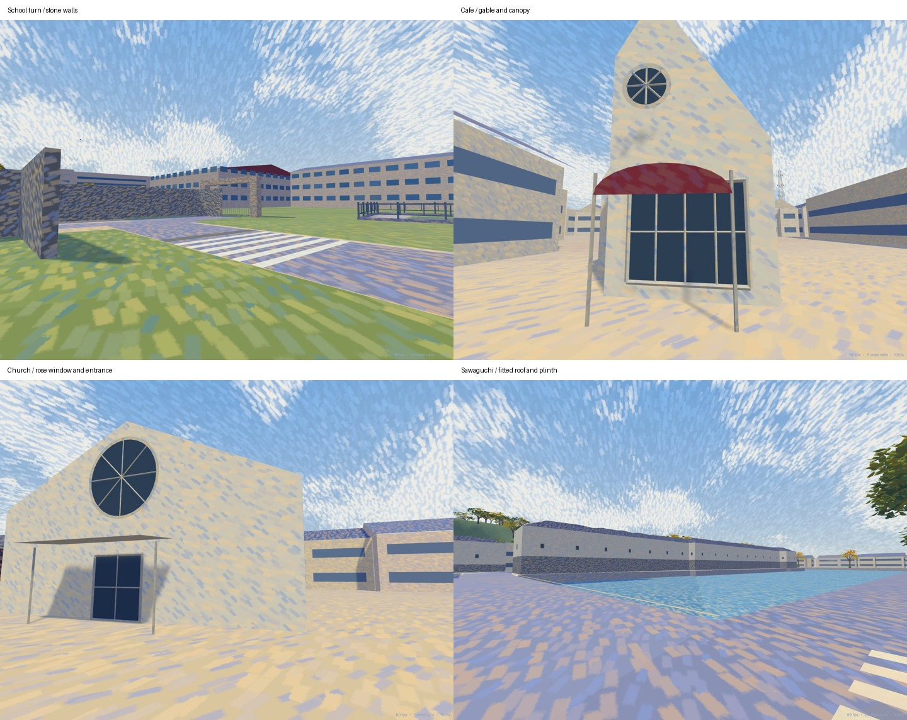

# Field photograph survey and model refinement

Photographs: **2026-10-29**. Review and verification: **2026-10-30 JST**.

All **78 HEIC files in `10.29/`** were visually inspected. This extends the earlier eight-photo university-gate refinement to the photographed route around the castle and middle moat. The originals remain unchanged; no source photograph, transient pedestrian, vehicle, shop poster or map-board image is shipped as a model texture.

[Per-photo position index](field-survey/photo-index.md) · [GPS/EXIF, hashes, nearest mapped roads and modeling outcomes](field-survey/photos-20261029.json) · [Authoritative geometry observations](../world/field-observations.json)


## Position registration and confidence

The origin, 32-degree bearing, metre scale, X mirror, practice bounds and walkable world bounds are unchanged. Original EXIF latitude/longitude is converted with `src/world/geography/coordinates.ts`. Camera headings are supporting evidence, not calibrated poses. Altitude above sea level is never treated as local terrain height.

The supplied camera fixes span approximately **X=-623.3–428.2, Z=29.8–447.3 m**. These are camera positions, not building corners or new map bounds. The existing walkable world remains X=-1060–420, Z=-155–870 m; the retained practice area remains X=-220–200, Z=-155–165 m.

Most photographs report horizontal GPS errors around 3–7 m. Position review combines the fix/error radius, heading, consecutive views, mapped road/shore outlines, building fronts and independently mapped points of interest. The index preserves the raw fix rather than silently replacing it with a guessed camera coordinate. House identities and metric facade dimensions cannot be proved from GPS alone.

- `IMG_0890/0891`: the camera fixes are about 8 m beyond the existing X=420 walkable boundary. The boundary is retained. Nearby covered scenery is reviewed, and the independently mapped communication tower is modeled as a distant upper silhouette; an unverified base building is not invented.
- `IMG_0929`: reported horizontal error is **53.7 m**. It supports the return-corridor appearance, not a unique-object relocation.
- `IMG_0930/0931/0933`: identical fixes recur despite elapsed time and changed views. A held fix cannot be ruled out. The unique gate in 0930 is not moved or recreated from those coordinates alone.
- `IMG_0934`: error is **21.4 m**. The auditorium rear and temporary office are recognizable; this is a consistency check on the existing campus model, not a new control point.
- `IMG_0911` and `IMG_0932` do not exist in the supplied folder. No missing images are inferred.

## Retained-shore limitation

The route review exposed an existing registration mismatch inside the retained practice scene: the source positions of the five eastern benches lie over its current water surface. The native footway and shore here are still schematic. A full road/shore coordinate migration would also require migrating nearby accident and saved-scenario positions; it is not silently performed as an architectural detail change.

The five new benches therefore keep their original OSM coordinates in `point` and an explicitly separate `placement` on the retained dry shore. Their registration offsets are **10.1–17.1 m**. This is **not geographic accuracy verification** for that strip. Existing core fencing is retained rather than adding the source rope line through an event goal. Native bench supports and public body clearance are tested at the actual model placements. The index and GPS plot show the original geographic fixes, not these adjusted placements. The retained strip remains a documented limitation and requires a separate coordinated road/scenario migration for geographic precision.

## Verifiable geographic references

The bounded [OSM source request](https://api.openstreetmap.org/api/0.6/map?bbox=136.2468,35.2701,136.2577,35.2773), downloaded for this review, supplies existing building outlines, way 121393441's school-road turn, seven stone-wall polygons, mapped benches/boards/lamps and communication-tower node 12625095277. Its SHA-256 and the selected element IDs are recorded in `world/field-observations.json`. Existing OSM source footprints and source-height metadata are retained; photo-informed geometry profiles are a separate small authoring layer. OSM-derived coordinates remain subject to the project's OpenStreetMap attribution and ODbL notice.

The [Catholic Kyoto Diocese directory](https://kyoto.catholic.jp/addres/Address_Table.htm) confirms the church identity/address; [the hotel's official access information](https://www.hch.jp/access/) confirms the hotel identity and middle-moat location. These support identity, not measured dimensions. A POI label can lie in a garden or forecourt; the church profile is registered to its photographed frontage and existing building outline, not blindly centered on the POI label. No new satellite or Street View comparison is claimed in this pass.

## Completed model changes

| Photographs | Verified scene and resulting model work |
| --- | --- |
| 0855–0857 | Align the stone-lined Nishi-school public-road turn to OSM way 121393441; retain shared road endpoints. Add the photographed private entrance apron, closed school gate, registered stone walls and zebra/blue cycle crossing. Widths and gate dimensions are photo estimates. |
| 0858–0862 | Keep the open lot and school-side context; connect the corrected street into the existing road. Clip obsolete low lot masonry out of the corrected public body corridor. Add mapped square lanterns along the photographed inner-moat corridor. |
| 0863–0866 | Refine the existing Higashi High School classroom to the four visible storeys, framed glazing and horizontal facade bands. Preserve footprint, entrance access and the wider school complex. Add observed green edge paint and static 30 road numerals; driver timing/rules are unchanged. |
| 0867–0871 | Refine Saigo's existing longhouse gate with timber posts, paired door/stud details and tiled roof; add mapped interpretation boards. Keep the stone corner and existing street connections. |
| 0872–0888 | Add the two mapped directories and five backed benches identified in the source. The retained practice shore continues to own its existing fence, avoiding a duplicate barrier across an event corridor. The benches are registered to the retained shore as described above. Exact timed-restriction pole assignment from 0879 remains unconfirmed, so existing traffic-signal/control logic is retained. |
| 0889–0894 | Add the photographed communication-tower silhouette at its OSM point, beyond the eastern walkable frame. Its estimated upper silhouette is decorative scenery; no operator identity, measured height or base-building reconstruction is claimed. Mapped east-junction wayfinding posts are added. Unconfirmed shop-front assignments are retained. |
| 0895–0898 | Refine the existing cafe footprint into its observed steep gable, ground glazing, round upper light and red curved canopy. Add the small photographed roadside shrine as a dimension/position estimate behind the shoulder. |
| 0899–0902 | Refine the church's gabled nave, circular radial window, thin metal entrance canopy, sheet-metal spire and cross; add the observed fan-palm forms within its garden, clear of the public road. |
| 0903–0907 | Refine the mapped low shop frontage with timber glazing, tiled roof and raised red gable. The round gold ornament is a crest panel, not a clock. No fictitious clock time or shop-poster text is added. |
| 0908–0910 | Retain the hotel footprint and form separate low street frontage and taller upper block, with glazing and a timber entrance canopy. The real forecourt/public street remains open. |
| 0912–0918 | Add mapped Iroha-matsu/Sawaguchi interpretation and wayfinding boards. Refine the two Sawaguchi turret wings with stone plinths, white walls, narrow barred windows and roofs fitted to their actual clipped footprints; no rectangular roof fills the courtyard. |
| 0919–0923 | Add the photographed exterior museum stair and white rails beside the mapped ground-level passage. It is a visual exhibit-access structure; no unverified accessible upper-floor route or interior is added. |
| 0924–0928 | Keep the existing bridge, water level and shore connections; add mapped guidepost and simple unbranded vending furniture at the existing kiosk context. |
| 0929–0934 | Use the views to check the return corridor and existing university model. Retain the uniquely unconfirmed gate and held/low-accuracy camera fixes as explicit uncertainties. |

### Kyobashiguchi follow-up (2026-10-30)

A street-view review at the bridge's castle end (x 38.8, z 75.6) showed a hollow bank corner and furniture standing in the road. Checked against photos 0867–0872 and the [bounded OSM request](https://api.openstreetmap.org/api/0.6/map?bbox=136.2510,35.2715,136.2540,35.2745):

- **Road alignment.** `NORTH_APPROACH` now follows OSM way 1499485466: straight north from the bridge to z≈89, a westward turn inside the masugata, then past Saigo's longhouse. The former satellite trace cut diagonally from the bridge and ran about 4 m west of the mapped road at the longhouse, which put the mapped boards and lamp on asphalt. With the unchanged road-cut shoulders, the generated walls fall within about 1 m of the mapped retaining walls (x 26.5/38.2, z 89.3/100.5). The satellite-traced tail to the inner-moat junction is unchanged. Events 02/05 keep their 1.85 m lane offsets on the new centreline. The lane ends are trimmed so each ordinary-traffic route keeps its smoothed length and its pose at the practice crossing, which leaves the clocks unchanged.
- **Bank corners.** The battered north bank stopped at x 24/40 and left an open triangular wedge, so the double-sided materials showed its inside (the reported gap and the diagonal "plank"). The opening now ends at the approach shoulders (x 25.5/38.5), and each end is closed as a faced stone corner.
- **Gangi.** Eight estimated stone treads (0.7 m deep) are cut into the enclosure's inner wall behind the 京橋口門と雁木 board, as in 0869/0870. The board keeps its OSM point, which now lies on the shoulder in front of the first riser.
- **Saigo frontage.** The 家老 西郷屋敷跡 board is set on the grass verge behind the kerb (0867). The 彦根市指定文化財 node is a small stone post at the gate in 0868, not a board.
- **Bridge end.** The two OSM lamps at the castle end are added. Photo 0872 shows a 30 km/h and no-parking sign on the east lamp for southbound traffic, and that sign is added there. The sign on the west lamp is seen only from behind, so it is not invented.

All new architectural heights, roof rises, stair dimensions, canopy projections, spire/tower heights and furniture dimensions are visual estimates unless a specific OSM height tag is recorded. The 5.5 m school retaining wall carries an OSM height tag. Photographs do not supply surveyed elevations or hidden facade/interior information. Existing distant trees and buildings outside the confirmed refinements are preserved.

## Construction and reproduction

`world/field-observations.json` is the reviewed source layer. `tools/field_photos.py` creates native architecture and static furniture through the established authoring pipeline. `tools/east_extension.py` uses those profiles before its generic building author. The compact browser camera envelopes match the same profiles through the source outline anchors (rounded to two decimals in camera transport); the full GIS document is not added to startup. `tools/university.py` and `university-layout.js` own the local corrected school road/apron; `castle_approach.py` owns the retained school/gate facades. No renderer offsets or simulation parameters are used to repair geometry.

```sh
npm ci
blender -b --factory-startup --python tools/build_impressionist.py -- --only ART_CastleApproach ART_ShigaCampus ART_WestMoat ART_EastHikoneBuildings
blender -b --factory-startup --python tools/build_native_models.py -- --only ART_CastleApproach ART_ShigaCampus ART_WestMoat ART_EastHikoneBuildings
node tools/build_collision.mjs
npm run check
node tools/check_routes.mjs
```

The optional macOS helper `swift tools/read_photo_metadata.swift 10.29 /tmp/photo-metadata` re-reads the originals using ImageIO. It is not used by model generation or browser startup. The checked-in evidence index records the reviewed file hashes and conversions.

## Verification and rendering cost

The [78-position transform check](field-survey/coordinate-check-20261030.json) reproduces every stored X/Z position and its inverse with no numerical discrepancy. It proves consistent use of the existing frame, not survey-grade GPS accuracy.

The [development-browser record](field-survey/browser-development-20261030.json) exercises the actual player in walking and cycling modes along the corrected school road, retained shore, eastern moat road and Sawaguchi approach: eight continuous traversals without waypoint teleportation. Existing walking event 01 and cycling event 07 also accept keyboard movement/look, switch replay views, reach results and return to the menu. Contact is invoked through the existing debug hook for this replay smoke check; it is not a naturalistic collision-rate experiment. The 390 px editor loads coordinate navigation without horizontal overflow. Browser console/page errors: zero.

The museum spur's first endpoint is an existing closed building threshold. Exterior body-clearance validation starts 0.85 m beyond it; no museum interior or new upper-floor circulation is claimed. The straight retained-shore fixture stops before its existing diagonal eastern corner.

[Same-page A/B rendering samples](field-survey/rendering-20261030.json) use frozen starting native programs/ground data and final programs in the same renderer, URL and fixed cameras: Chrome, 1280×800, reduced motion, two-second warmup and eight-second samples. Calls do not increase in these views:

| View | Draw calls before → after | Triangles before → after |
| --- | --- | --- |
| School turn | 36 → 36 | 801,210 → 801,938 |
| Church frontage | 7 → 7 | 69,939 → 103,276 |
| Sawaguchi | 26 → 26 | 3,615,648 → 3,665,122 |
| Practice junction | 110 → 110 | 1,526,407 → 1,575,961 |

Resident scene geometry buffers rise from 68,234,688 to 72,668,972 bytes (**+4.43 MB, +6.5%**). These are geometry buffers, not total browser memory. Median frames remain about 16.7 ms and p95 about 17.6–17.7 ms in this capped desktop sample; they establish no mobile or VR performance result. Added facade detail has a measurable geometry cost, especially in the close church view.

`npm run check` passes strict type checking, generated-document checking, all **306 tests (zero failures/skips)** and the production build. `node tools/check_routes.mjs` checks **46 vehicle routes, zero failures**. The four focused field tests are rerun after improving a diagnostic label. Collision and atlas outputs are regenerated from authors; `git diff --check` passes. The production build retains Vite's large-chunk advisory.

The [production-preview browser record](field-survey/browser-production-20261030.json) repeats all eight walking/cycling traversals, both event/replay smoke flows and the 390 px editor check against the built site, with zero console/page errors. [Validation and preservation record](field-survey/verification-20261030.json) identifies the regenerated files and confirms original photo hashes and unrelated starting files are preserved.

## Model views

These are simulator captures, not reference photographs or photogrammetric comparisons. Starting/final views use the same cameras. Final-only detail views also show the [four-storey classroom](field-survey/classroom-final.jpg), [longhouse gate](field-survey/longhouse-final.jpg), [visual exterior stair](field-survey/stair-final.jpg) and [registered shore benches](field-survey/benches-final.jpg). The last view depicts the disclosed local registration, not the OSM positions.



| Area | Starting scene | Final scene |
| --- | --- | --- |
| School turn | [Before](field-survey/school-before.jpg) | [After](field-survey/school-final.jpg) |
| Cafe | [Before](field-survey/cafe-before.jpg) | [After](field-survey/cafe-final.jpg) |
| Church | [Before](field-survey/church-before.jpg) | [After](field-survey/church-final.jpg) |
| Hotel | [Before](field-survey/hotel-before.jpg) | [After](field-survey/hotel-final.jpg) |
| Sawaguchi | [Before](field-survey/turret-before.jpg) | [After](field-survey/turret-final.jpg) |

No real phone or VR headset is tested. No commit, push or deployment is performed.
