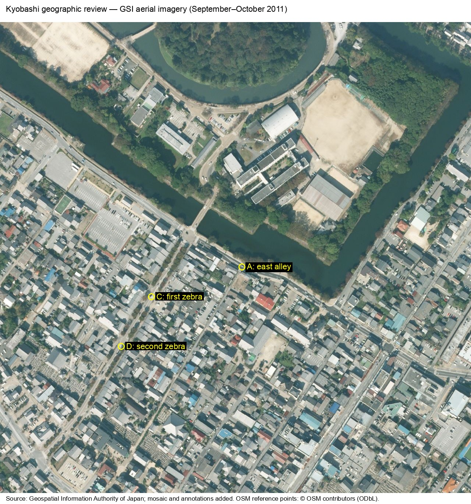
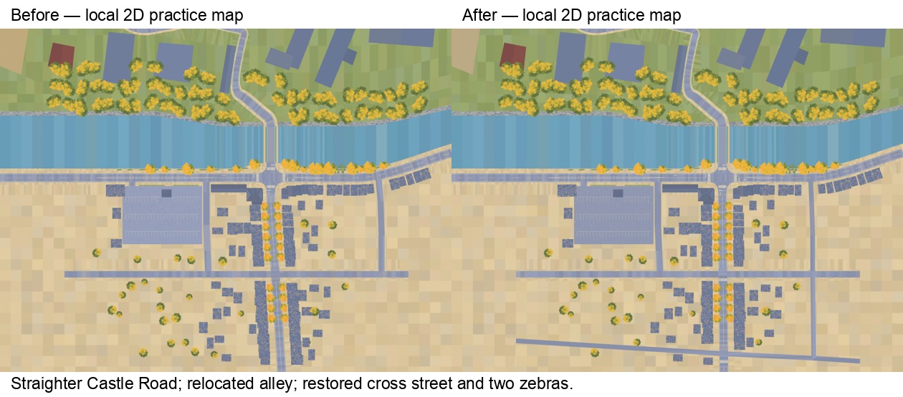

# Kyobashi geographic audit — 29 October 2026

The practice map has local corrections to the eastern alley, the southern Castle Road alignment,
the next town cross street and two unsignalised crossings. This is a traffic-practice scene with
approximate dimensions, not a surveyed digital twin. The work preserves the junction's local
coordinate frame and existing scene architecture.

## Sources actually inspected

| Reference | Access and use | Limits |
| --- | --- | --- |
| [GSI seamless aerial photographs](https://maps.gsi.go.jp/#18/35.27246/136.25263/&base=seamlessphoto&ls=seamlessphoto&disp=1) | Downloaded and visually inspected zoom-18 tiles around Kyobashi; approximately 0.488 ground metres per source pixel. | The [capture-period metadata](https://maps.gsi.go.jp/xyz/seamlessphoto_spec/11/1799/809.geojson) identifies **September–October 2011**, not 2026. Tile modification dates are not capture dates. Enlarging the images does not add detail. |
| [GSI pale map](https://maps.gsi.go.jp/#18/35.27246/136.25263/&base=pale&ls=pale&disp=1) | Inspected the road connections, bridge, moat and block outlines. | Reference only; no pale-map raster or traced pale-map database is redistributed. |
| [OpenStreetMap API extract](https://api.openstreetmap.org/api/0.6/map?bbox=136.2495,35.2700,136.2550,35.2742) | Downloaded OSM XML on 29 October 2026; inspected highway centre lines, lane counts, bridge and crossing tags. | Community data can be incomplete or internally inconsistent. Some footway ways say `uncontrolled` while their junction crossing nodes correctly say `traffic_signals`; these tags were not applied blindly. |
| [Google satellite reference](https://www.google.com/maps/@35.2725151,136.2517411,254m/data=!3m1!1e3) and [junction panorama](https://www.google.com/maps/@?api=1&map_action=pano&pano=2ktrhAY4ZkkBfA6R_NUjeQ&heading=97.94&pitch=13.47) | Both attempted. The web reader could not access them, and local browser access was disabled in Work settings. | **No new Google satellite or Street View comparison was completed.** Existing code comments about earlier owner photographs/panoramas describe historical evidence, not a fresh observation. |

The [source manifest](geography/sources-20261029.json) records downloaded tile URLs and hashes,
OSM element versions/timestamps and the retained geographic transform. The raw OSM download's
hash is recorded, without redistributing its user metadata.



Source: Geospatial Information Authority of Japan; tiles assembled and annotated. OSM reference
points: © OpenStreetMap contributors, [ODbL](https://www.openstreetmap.org/copyright).

## Layout and dependency findings

`tools/road_network.py` creates the road, footway and kerb polygons, ground triangles and editor
surfaces. `src/world/generators/road-layout.js` applies browser placements and clears buildings
from streets. Native construction programs in `models/` draw the live scene; historical GLBs
remain the editor-image author's input and offline test fixtures. `tools/build_collision.mjs`
uses the live native geometry and placements. Changing only the editor bitmap would therefore
leave the simulation inconsistent.

The editor's X/Z plane is rotated relative to geographic north. The existing transform in
`castle-layout.js` uses a 32-degree rotation and anchors the bridge midpoint at local (32, 56.8)
and approximately 35.27246 N, 136.2526297 E. This is an approximate registration. Aerial and OSM
features differ by several metres near the main junction; no centimetre accuracy is claimed.

## Findings and corrections

| Feature | Existing issue or finding | Evidence | Completed change |
| --- | --- | --- | --- |
| Eastern alley | At x≈132–135, about 18–20 m too far east; ended at the first southern street. | Aerial block boundaries; OSM ways [122922003](https://www.openstreetmap.org/way/122922003), [122922017](https://www.openstreetmap.org/way/122922017), [122921963](https://www.openstreetmap.org/way/122921963). | Moved to x≈114–117 and continued to the next block. Removed the displaced road and its invented separate footways; the replacement is shared asphalt. The main-road edge line opens at its new mouth. |
| Castle Road south of the junction | The old centre line drifted east by 0.065 m per southward metre: 6.5 m at z=-100 and 10.1 m at z=-155. The reference road remains nearly straight. | Aerial alignment; OSM way [180831396](https://www.openstreetmap.org/way/180831396) gives local x≈32.1 at z=-26, 32.6 at z=-62, 32.9 at z=-116 and 33.2 at z=-138 under the retained transform. | Reduced the local drift to 0.009 m/m (1.4 m over 155 m). Moved the affected southern vehicle route points in events 02/05 by the same coordinate difference; regenerated both browser and editor built-ins. Speeds, clocks, triggers and junction coordinates are retained. |
| Second southern cross street | Missing, leaving an entire block without its real east/west connection. | Aerial; OSM ways [122921566](https://www.openstreetmap.org/way/122921566), [122921949](https://www.openstreetmap.org/way/122921949), [122921965](https://www.openstreetmap.org/way/122921965). | Added the slightly oblique street near z≈-138, connected to Castle Road and the extended alley. Retained the first cross street's existing local tie point. |
| Southern crossings | Neither crossing was painted; the continuous road lines and kerb caps did not provide matching crossing approaches. | Aerial markings; OSM crossing nodes [12722683977](https://www.openstreetmap.org/node/12722683977) and [12722683974](https://www.openstreetmap.org/node/12722683974). Both are marked as zebra, without signals. | Added zebras centred at local z=-69 and -145.5, interrupted the centre/edge lines, opened both kerb returns and added tactile warning surfaces. No traffic-signal phase was invented for these crossings. |
| Buildings and planting | Imported footprints could overlap the corrected streets. Most town roofs are generic models rather than surveyed building outlines. | The existing source/placement inventory, aerial block pattern and regenerated collision geometry. | Cleared only overlapping placements, retained the other models and frontages, and kept street trees away from the new crossing approaches. Exact parcel/facade restoration remains unverified. |
| Main junction and lanes | Four-way topology, bridge connection, two main-road traffic lanes and four junction crossings agree at the structural level. | GSI reference; OSM junction node [443613692](https://www.openstreetmap.org/node/443613692), Route 25 ways 26826728/1499485468 and bridge way 180831397. | Retained the established junction and all five signal installations. Old aerial imagery cannot resolve the present pole inventory or invalidate newer owner photographs. |
| Terrain, bridge and moat | The retained bridge span is 34.4 m; the OSM bridge centre-line segment is about 35.4 m. Raised castle ground is a stylised visual model. | Aerial water/land boundaries, OSM bridge outline and existing terrain sources. | Retained the bridge, moat and terrain. No new elevation measurement or current water-level measurement was available. |

The new minor streets use a **4.4 m authored asphalt width**. This is a visual estimate appropriate
to the observed narrow streets and single-lane OSM classification, not an authoritative width.
Existing main-road/footway widths, bridge kerb heights, signal timing, signage restrictions and
the western parking-exit practice arrangement remain approximate and were not re-surveyed.



## Shared source and reproduction

The small [town street dataset](../world/town-streets.json) is the shared source for Python road
construction, JavaScript placement clearance, southern alignment and crossing openings. Its
ODbL notice applies to that dataset. Code is not relicensed by this notice. Geographic references
load only when a user opens their links; the simulator makes no new map-service requests.

Regenerate from this checkout, without Unity or a full upstream sync:

```bash
npm ci
node tools/sync.mjs --events-only
blender -b --factory-startup --python tools/build_impressionist.py -- --only ART_KyobashiRoads ART_KyobashiLand ART_PavingDetails
blender -b --factory-startup --python tools/build_native_models.py -- --only ART_KyobashiRoads ART_KyobashiLand ART_PavingDetails
node tools/build_collision.mjs
npm run check
node tools/check_routes.mjs
```

Run the two author commands **in that order**: paving heights read the ground exported by the
historical author. Both editor images are generated, with their coordinate registration, by
`tools/build_editor_map.py`; no file in `data/` is patched manually.

The ordinary-traffic endpoints in events 02/05 extend by approximately 0.207 m to compensate for
the shorter, straighter southern road. The existing regression still requires the original
smoothed route lengths, crossing positions/headings at the same travelled distances, 5-second
departures and 36 km/h speeds. That test is retained unchanged.

## Verification and remaining limits

Validation results and browser/rendering evidence are recorded after the final regeneration
in [the verification record](geography/verification-20261029.json).

`npm run check` passes **279 tests, zero failures/skips**, strict types, generated references and
the production build. The route checker passes **46 routes** across browser scenarios and editor
templates. Targeted checks for 02/05 reach the goal in the cautious and lawful reference runs.
All non-route settings in those two event sources are unchanged; the other eight event sources,
the open-world manifest, simulation implementation and imported layout are unchanged.

Headless Chrome checks cover walking 01/02/05, cycling 07, keyboard look/movement, replay to its
end, results and return to the menu. Contact is supplied by the existing debug helper for that
UI check; this is not an accident-rate measurement. The real participant controller traverses
the corrected alley and southern cross street in both modes with a fixed 1/60-second step;
the bicycle uses steering input. Editor location selection preserves the scenario, and the
390 px layout, forced colours and attribution links are checked. Production preview also opens
the simulator and editor with touch/reduced-motion emulation. There are no browser console/page
errors or failed resources in these checks. [Editor view](geography/editor-20261029.jpg) ·
[Southern streets in the live renderer](geography/runtime-south-20261029.jpg).

The [fixed-view A/B record](geography/rendering-20261029.json) uses the same Chrome tab/URL,
reloaded from frozen before resources to the corrected resources, at 1280×800 with reduced
motion. Each view has a two-second warmup and an eight-second sample. Junction draw calls stay
117; alley calls change 68→70 and southern-view calls 20→24. Native geometry buffers change
60,779,232→61,208,932 bytes (+0.71%). Frame medians remain about 16.7 ms and p95 is at most
18.6 ms in these frame-capped desktop samples. There is no claimed phone/VR speed gain.

The geographic review establishes these local topology/alignment corrections. It does not
establish current surveyed lane/footway widths, accessible kerb-ramp gradients, signal cycles,
pole coordinates, traffic-order signs, facade setbacks, castle elevations, or every road in
the full castle/university extension. The practice parking exits remain authored teaching
locations, not a current parking-management plan. Google imagery and Street View were unavailable;
no on-site visit, real phone, Quest or Unity run was performed. No commit, push or deployment
is part of this audit.

Deferred simplifications are explicit: Route 25's western curvature, the detailed northern
bridge approach and the western parking-lot/access arrangement still differ from source outlines.
They require a coordinated corridor/route/footway revision with better current curb and access
evidence; this local patch does not claim those areas have been fully corrected. Generic building
footprints, the castle/university background and vegetation remain visual approximations.

Sources are used according to the [GSI tile list](https://maps.gsi.go.jp/development/ichiran.html),
[GSI content terms](https://www.gsi.go.jp/kikakuchousei/kikakuchousei40182.html) and
[OSM licence/attribution](https://www.openstreetmap.org/copyright). The only redistributed
external raster is the attributed GSI aerial reference; no Google imagery is copied.
