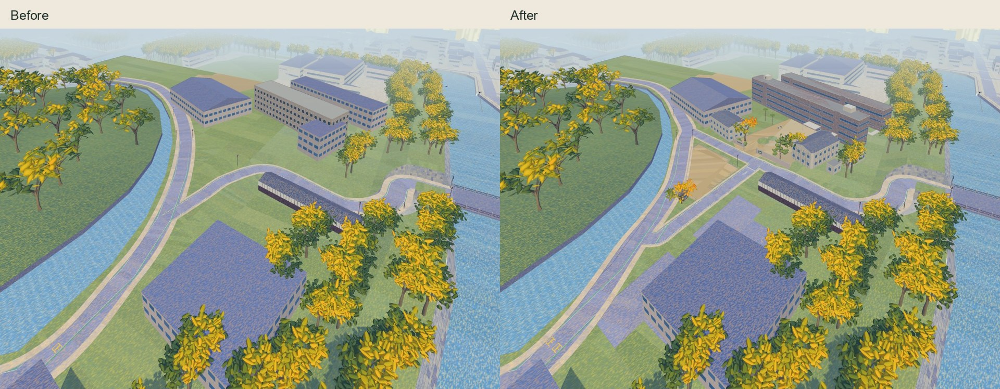
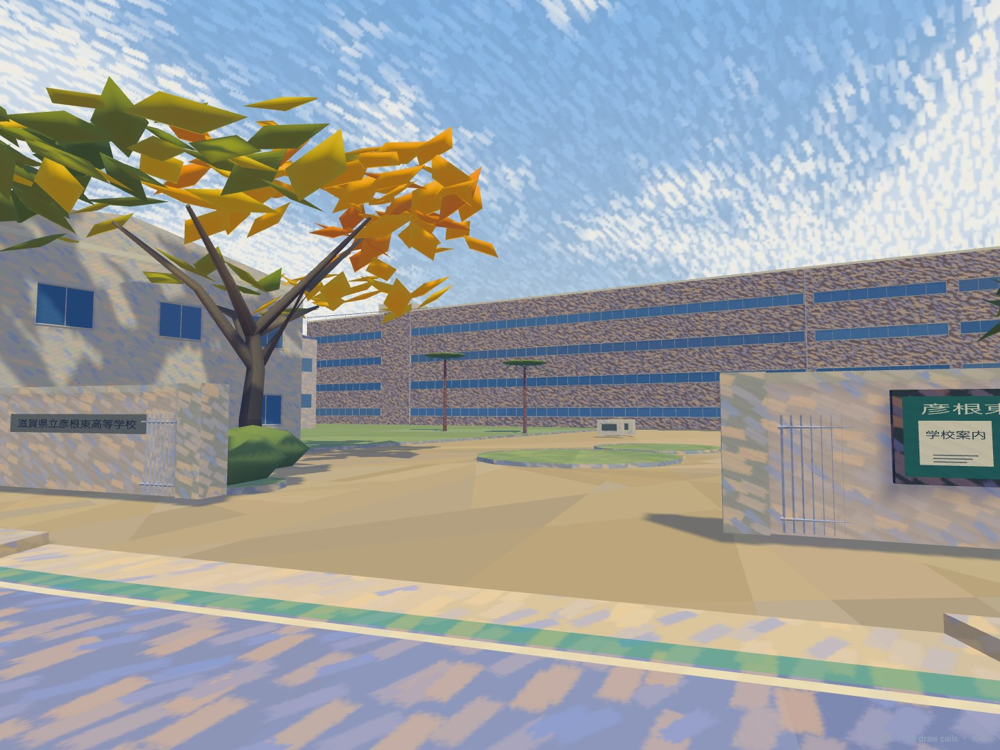
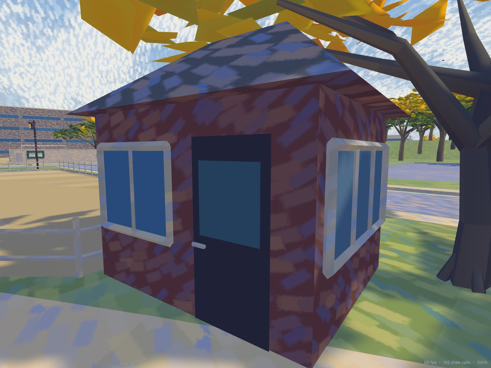

# Higashi High School / Otemae frontage, 30 October 2026

This is a local rebuild of the area shown in the owner's screenshot, based on
`10.29/IMG_0864.HEIC`, `IMG_0865.HEIC` and `IMG_0866.HEIC`. It preserves the existing
geographic origin, metre scale, renderer X reflection and simulation rules.

## Evidence and confidence

| Evidence | Observation and use |
| --- | --- |
| Owner 0864, 35.2737617 N / 136.2524250 E, local (-60.56, 169.82), heading 89.57° true | The public fork, parking entrance kiosk, fence, school frontage and continuous classroom window strips. |
| Owner 0865, 35.2734450 N / 136.2528700 E, local (-7.59, 161.36), heading 93.24° true | Open school gate, grey concrete wing walls, horizontal school plaque, bulletin case, forecourt planting, palms, four-storey brown slab and roof clock. |
| Owner 0866, 35.2734383 N / 136.2528833 E, local (-6.16, 161.37), heading 21.24° true | Pale unmarked parking ground, bamboo-style fence, and the wooded castle backdrop. |
| [OpenStreetMap](https://www.openstreetmap.org/way/380217941), retrieved 30 October 2026 | Central parking polygon 380217941, west parking 1376686183, school blocks 380217945/949/951 and smaller roof/link polygons. Public roads 59265942, 37825600 and 1499485466/7 share their actual junction nodes. Selected raw coordinates and IDs are frozen in `world/higashi-frontage.json`. © OpenStreetMap contributors, ODbL 1.0. |
| [GSI photograph layer](https://maps.gsi.go.jp/#18/35.2736/136.2529/&base=seamlessphoto) | Sixteen native zoom-18 tiles around the frontage were inspected to confirm parking land use, footprints, roof axes and entrance/forecourt relationships. Retrieval date is not the photograph capture date. Source: Geospatial Information Authority of Japan; interpretation processed by this project. No aerial image is shipped. [Layer and usage information](https://maps.gsi.go.jp/development/ichiran.html), [GSI terms](https://www.gsi.go.jp/kikakuchousei/kikakuchousei40182.html). |
| [Official school campus plan, page 2](https://www.hikonehg-h.shiga-ec.ed.jp/blog/wp-content/uploads/2025/12/cec9288c7f8dab3ef28a83d2e278a42c-1.pdf) | The extracted plan labels confirm the main/service gates, entrance, four-storey first block, three-storey second block and building relationships. It is a schematic reference, not a dimensional survey. No plan image is redistributed. |

Photo GPS reports approximately 4.2 m horizontal uncertainty. Gate dimensions, kiosk
registration, tree positions and building heights are visual estimates. Google satellite
and Street View were **not accessed** in this pass; the school's official 360-page request
returned HTTP 403. Hidden elevations are simplified, consistent continuations of known
walls, floors, windows and roofs. They are not presented as photographed detail.

## Corrections

- Replace the empty grass triangle with the mapped Otemae gravel parking area, interrupted
  bamboo-style perimeter and a closed, four-sided timber kiosk with a hipped roof. The west
  parking polygon is also paved. No unsupported stall count or parked-car inventory is added.
- Restore the missing public road on the school's western edge. Both branches meet the same
  mapped junction, and the moat road meets the other end of the triangle. Correct only the
  local road tail; the Kyobashi practice junction and event route/timing sources stay intact.
- Rebuild the photographed school gate as concrete wing walls, piers and retracted steel
  leaves with an open passage, a readable school name and a small bulletin case. Bulletin
  graphics are original generic school/traffic-safety information, not a transcription of
  unreadable real notices.
- Replace the older school slab/wing/connector estimates with their OSM outlines. Model
  four-storey and three-storey brown window-band slabs, the entrance wing, smaller links and
  Ginkgo hall. Covered links have columns and roofs rather than solid walls across the court.
- Close all roof and side volumes, add supported roof headhouses/clock, coping/downpipes,
  observed palms and gate-side trees/shrubs. Two pale memorial blocks have no invented text.
- Replace the old lawn surface partition instead of stacking a parking decal. Existing public
  road/footway polygons take precedence. The same partitions feed native meshes, exported
  GLBs, Ground, editor images and collision. Gate walls and kiosk have individual camera
  envelopes so the open gate remains usable by replay cameras.
- Drop the kerbs across the mapped parking access and open school gate so the entries have
  continuous flush bedding, rather than a 15 cm barrier across them.
- End green edge paint at the actual junction openings and add the photographed static stop
  marking. This does not add or change event driver rules.

New parking/school footprints occupy approximately **X -82..118, Z 107..205 m**. The local
road correction joins the retained road near **(-98,167)** and **(31,232)**. Existing school
gymnasium, distant hall, moat alignment and broader castle terrain remain outside this rebuild.

## Authoring and regeneration

`world/higashi-frontage.json` owns the reviewed source registration and explicit estimates.
`castle-approach.js` exposes the shared school footprints, local roads and camera envelopes.
`tools/higashi_school.py` builds the local architecture, landscaping, furniture and markings;
`tools/road_network.py` supplies the conforming ground partition.

```sh
npm ci
blender -b --factory-startup --python tools/build_impressionist.py -- --only ART_CastleApproach ART_KyobashiLand ART_KyobashiRoads ART_KyobashiBanks
blender -b --factory-startup --python tools/build_native_models.py -- --only ART_CastleApproach ART_KyobashiLand ART_KyobashiRoads ART_KyobashiBanks
node tools/build_collision.mjs
blender -b --factory-startup --python tools/build_editor_map.py
npm run check
node tools/check_routes.mjs
```

## Validation







`npm run check` passed: **318 tests, zero failures and zero skips**, including typechecking,
generated-reference verification, event checking and the production build. The independent
route checker passed all **46 vehicle routes**. The focused school/approach/seam group passed
**23 tests**, including supported parking/gate entries, flush access beds, closed roofs,
uncovered courtyards, readable notice surfaces and actual camera-wall blocking at both LODs.

Real-controller browser checks traversed the branch, school-side road, moat road, school gate,
parking entry and rear court in walking and bicycle modes: **12 completed traversals**.
Walking event 01 and cycling event 07 retained keyboard movement/look, participant replay,
replay completion, results and return to the menu. The 390 px touch/reduced-motion editor
retained the requested (18.2,169.7) coordinates without horizontal overflow. Console errors: none.

The regression pass caught cubic road anticipation moving the old vehicle lanes, nonmatching
small curb triangles in exported ground, and covered-link roof materials omitted by camera
envelopes. The fixes preserve the existing approach through Z=145, use the same polygon area
threshold for retained ground, and keep closed link roofs in the existing structural material
family. The parking/campus grounds subtract original convex public strips to avoid coincident
fragments. The two access beds are lowered in the source partition, with no renderer offset.

All **86 original HEIC files** match the task-start fingerprints. The geographic frame,
world encounter manifest, simulation source and existing university street/path/kerb groups
retain their starting values. No commit or push was made.

No real-phone or real-world survey accuracy is implied by desktop browser checks.

The kiosk has an inferred rear service door so the four-sided volume has plausible access;
its position is not photographed. The castle-side retaining wall and wooded relief seen
beyond the parking in 0866 retain the existing broader terrain model, without a new survey.

The production preview also passed at 390 × 844 with touch and reduced motion: no overflow,
console errors, failed requests or runtime GLB requests. Four sampled access/parking/road
heights match the authored 0.01 m surface. This is browser emulation, not a real phone.

[Validation details](higashi-frontage/validation.json) and
[same-page rendering samples](higashi-frontage/rendering.json) accompany the images.

| Fixed view | Calls before → after | Triangles before → after | Median ms before → after | P95 ms before → after |
| --- | --- | --- | --- | --- |
| gate | 23 → 26 | 1,432,258 → 1,469,415 | 16.7 → 16.7 | 17.6 → 17.6 |
| parking | 39 → 40 | 3,967,236 → 4,002,898 | 16.7 → 16.7 | 17.4 → 17.7 |
| overview | 70 → 73 | 1,956,983 → 1,987,714 | 16.7 → 16.6 | 17.5 → 17.5 |
| junction | 110 → 111 | 1,588,505 → 1,617,974 | 16.7 → 16.6 | 17.6 → 17.3 |

Scene buffers: 74,712,877 → 76,692,064 bytes (+2.65%). The same page,
renderer and final placement rules load frozen starting programs/data, then final programs/data;
each view has a two-second warmup and eight-second sample at 1280 × 800 with reduced motion.
This measures the added rendering cost, not a laptop FPS improvement or real-phone performance.
