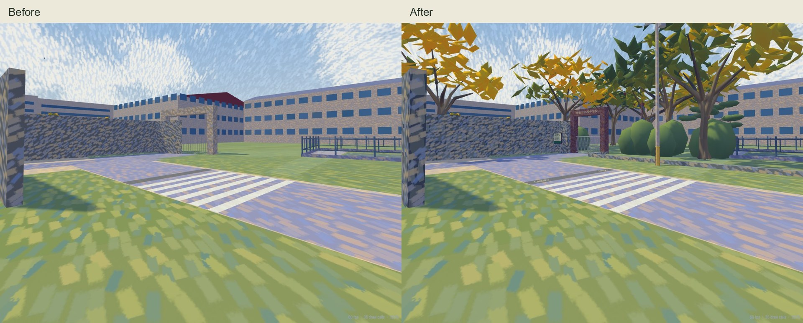
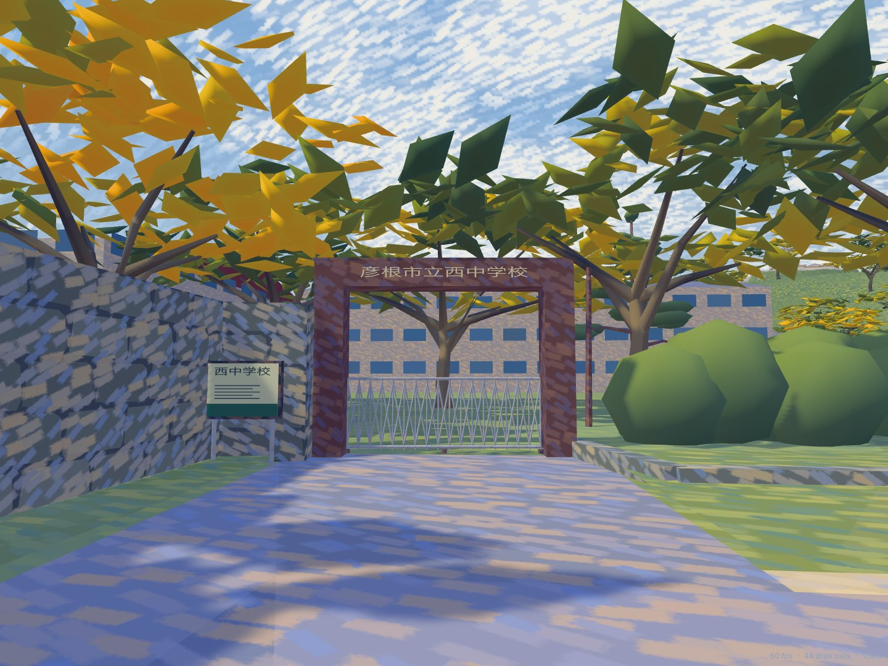

# Nishi school frontage, 30 October 2026

Local refinement of Hikone Municipal Nishi Junior High School beside Shiga University.
The owner's **IMG_0855 and IMG_0857** are the primary observations; **0856 and 0858–0861**
were also inspected to distinguish the stone corner, gate, crossing, tree screen and open lot.
The existing metre frame, road vertices, school building footprints, terrain and simulation
parameters are retained. The gate remains closed, as photographed.

## Evidence

| Source | Use |
| --- | --- |
| 0855: 35.276750 N, 136.247878 E; local (-587.27,232.97), heading 29.18° true | South approach between stone walls; brown portal, closed grille, street lamp and roadside signs. |
| 0856/0857: 35.276745 N, 136.248108 E; local (-569.25,243.57), headings 319.80° / 353.52° true | Return of the stone wall, portal proportions, crossing and blue bicycle strip, pole, planting and notice case. |
| 0858–0861 | Dense narrow evergreens along the school lane, utility corridor, open gravel/grass lot and its timber/rope boundary. Existing lot and nearby buildings are retained. |
| [Hikone City school directory](https://www.city.hikone.lg.jp/kosodate/kosodate_shien/1/hoiku/2/9631.html) | Confirms the school identity and address at Kinkicho 8-1. The gate's name is independently readable in 0855/0857. |
| Existing OSM registration, [API extract retrieved earlier on the same day](https://api.openstreetmap.org/api/0.6/map?bbox=136.2468,35.2712,136.2534,35.2777) | Retains the public road from way 121393441 and six stone-wall outlines from ways 1449647548/9 and 1481336254–7. © OpenStreetMap contributors, ODbL 1.0. The already-corrected long middle-moat wall 1449647547 is preserved. |

`world/nishi-frontage.json` records the source photo fingerprints, GPS, dimensions and
estimates. Reported photo positioning uncertainty is approximately **3.6–6.2 m**. Widths,
tree placement and small fixtures are visual estimates, not a survey. Species names select
silhouette recipes; they do not assert a botanical identification.

No new satellite or Street View imagery was accessed in this pass. The OSM webpage was not
accessible through the web tool; the registered coordinates and cached same-day API extract
were used. School facades largely hidden in the photos are not claimed as newly verified.

## Changes

- Replace the generic grey stone portal with a closed, four-sided brown frame, coping,
  readable **彦根市立西中学校** mesh lettering and a diamond accordion grille with feet/rails.
  The estimated outer width is 5.6 m and height 4.2 m; the registered centre stays **(-587,263.2)**.
- Give the six existing corner walls shallow irregular masonry faces while retaining their
  registered height and footprint. The inherited pointed tip of way 1481336257 crossed the
  doorway; the owner photos show it ending at the left pier. Only this tip is trimmed to the
  pier, with its original polygon retained as `sourceOutline` in the observation record.
- Restore the photographed tree screen, palms, shrubs and low stone footing on the right,
  keeping roots and street furniture outside the public turn. Replace the neighboring row's
  disconnected foliage stacks with branched cedar silhouettes at the same existing positions.
- Add the curved street lamp, crossing sign, transformer/distribution pole with striped sleeve,
  insulators and sagging wires connected to the existing next pole. No unsupported cable end
  is attached to the shorter lamp.
- Add paired bicycle symbols to the existing blue crossing strip. The full-resolution 0855
  crop resolves the truck/bus symbol, route-bus exception and timetable; these are static
  photo-date graphics. No traffic timing or driver policy is changed, and current restrictions
  are not asserted. The source plate reads March 15–May 15, 8–18; May 16–October 31, Sundays
  and holidays, 8–18, with a route-bus exception.
- Add a small original school notice graphic, without fabricating unreadable event posters.
  Give gate and walls separate camera envelopes so the public road stays open while actual
  stone/metal surfaces block camera rays. Stone and metal structural materials are included
  in the existing footprint-based camera filter.

The main frontage work is around **X -604..-566, Z 234..285 m**; the retained conifer row lies
near **X -537, Z 269..299 m**. Existing road topology, Ground surfaces, school buildings and
pool, broader castle terrain and earlier Higashi/university refinements are preserved.

## Authoring and regeneration

`tools/nishi_school.py` owns the local geometry and is called after the shared field-photo
pigment pass, preserving the brown portal and grey stones. `tools/university.py` owns the
existing adjacent evergreen row. Runtime geometry remains native Three.js; no photo texture
or online map is loaded by the simulator.

```sh
npm ci
blender -b --factory-startup --python tools/build_impressionist.py -- --only ART_EastHikoneBuildings ART_WestMoat
blender -b --factory-startup --python tools/build_native_models.py -- --only ART_EastHikoneBuildings ART_WestMoat
node tools/build_collision.mjs
npm run check
node tools/check_routes.mjs
```

The model export refreshes the editor atlas when the East Hikone composite is selected.
The final check passed **321 tests, zero failures and zero skips**, including typechecking,
generated-reference verification, the event checker and the production build. All **46
vehicle routes** passed the independent route checker. Native high/low geometry checks verify
nameplate visibility, actual wall camera obstruction, the closed gate and an open public body
corridor; readable lettering order was also inspected in the rendered front view.

Real-controller browser checks completed the approach, public turn, gate apron, school lane
and lot entry in walking and bicycle modes: **10 completed traversals**. Walking event 01 and
cycling event 07 retained keyboard movement/look, participant replay, replay completion,
results and return to the menu. The editor at 390 px retained (-587,253) without horizontal
overflow. Console errors: none.

The production preview at 390 × 844 with touch/reduced motion had no overflow, failed
requests, console errors or runtime GLB requests. Three sampled public road heights remained
0.01 m. This is desktop browser emulation, **not a real-phone test**.

All **86 original HEIC files**, all **10 event sources**, simulation code, geographic frame,
encounter manifest, Ground data and the earlier Higashi profile/native models match their
task-start fingerprints. No commit or push was made. [Validation details](nishi-frontage/validation.json).





## Rendering cost

Same page, renderer and placements, loading frozen starting programs/data and then final
programs/data, at 1280 × 800 with reduced motion. Each view uses two seconds of warmup and
eight seconds of samples. This is an A/B rendering-cost check, not a laptop FPS improvement
or real-phone performance claim. [Raw samples](nishi-frontage/rendering.json).

| View | Calls before → after | Triangles before → after | Median ms before → after | P95 ms before → after |
| --- | --- | --- | --- | --- |
| gate | 49 → 49 | 2,473,108 → 2,495,018 | 16.7 → 16.7 | 18.1 → 16.9 |
| turn | 38 → 38 | 893,379 → 915,281 | 16.7 → 16.7 | 17.8 → 18.3 |
| overview | 58 → 58 | 4,397,985 → 4,419,895 | 16.8 → 16.7 | 17.7 → 18.0 |
| junction | 111 → 111 | 1,617,974 → 1,640,604 | 16.7 → 16.7 | 17.6 → 17.5 |

Scene buffers: 76,692,064 → 78,135,657 bytes (+1.88%).
