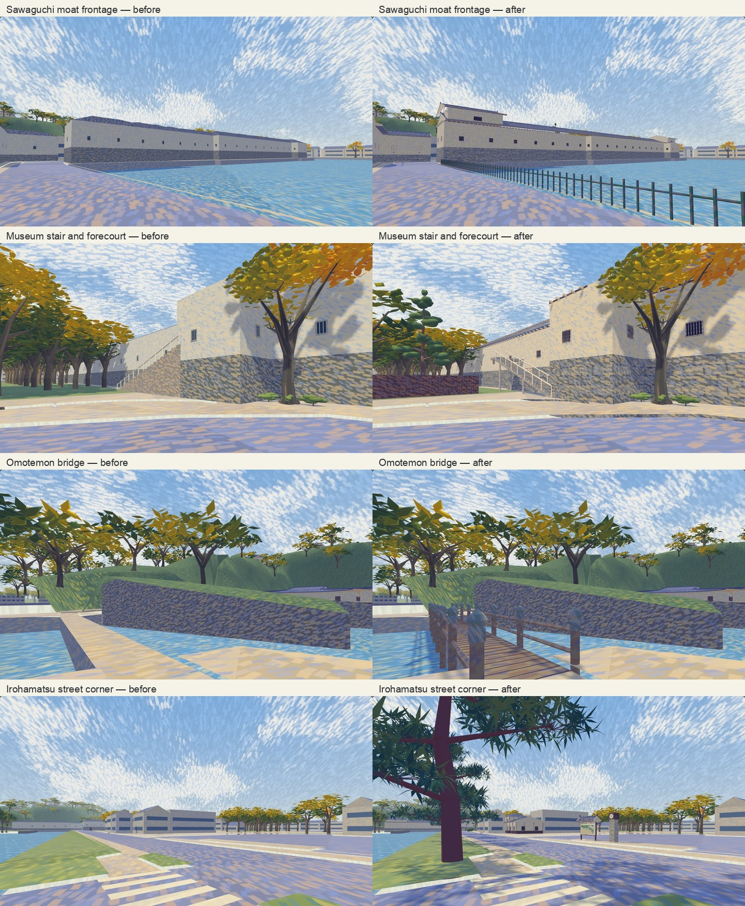

# North streetscape at pedestrian height

Reviewed on 30 October 2026 against all 21 originals in local `08-iroha-sawaguchi` and `09-omotemon-return`. Photos remain in ignored `field-photos/`; neither originals nor crops are published or used as textures.

## Evidence and limits

The existing [geographic frame](../world/geographic-frame.json) is unchanged: map metres, +Z bearing 32 degrees, +X bearing 122 degrees. Registered outlines and road/footway axes come from the frozen OSM extract recorded in [north-streetscape.json](../world/north-streetscape.json), under ODbL 1.0. Photo-relative placements, dimensions, roof tiers and vegetation rhythm are estimates rather than a survey. Original source points and adjusted placements remain separate.

Owner photographs were captured on 29 October 2026. GPS errors are generally 3–6 m here. IMG_0929 has a 53.7 m error; IMG_0930, 0931 and 0933 share a held coordinate despite different views/times. Their content informs corridor character, but the distinctive gate in 0930 is not newly placed. EXIF altitude is not terrain height. Hidden elevations are closed using coherent construction, without claiming they were photographed.

[Hikone City's cultural-property descriptions](https://www.city.hikone.lg.jp/kakuka/kanko_bunka/8/2_1/3/4581.html) (updated 2 September 2024, retrieved 30 October 2026) distinguish the historic Sawaguchi wing from the reconstructed museum wing and identify the end turret and gabled termination. [The official castle site](https://hikonecastle.com/about.html) confirms the Irohamatsu name and its historic count. These pages supplied factual identification; no website artwork is redistributed. No new Google aerial or Street View comparison is claimed.

## Local changes

| Photographs | Problem in the starting scene | Reconstruction |
| --- | --- | --- |
| 0912–0913 | Generic houses and missing old-pine row, clock and directory; blank interpretation | Two observed house profiles, eight estimated old pines with needle fans, clock pillar and roofed directory, legible Irohamatsu interpretation |
| 0914–0916 | Placeholder maps and missing monument | Original schematics derived from registered OSM geometry, poem-board silhouette, stepped stone monument and title post, low map beside the retained northern guidepost. Photo GPS alone did not reliably distinguish the two sides of the road |
| 0917–0919 | Flat turret masses and no projecting eaves; concave returns could face inward | Separate historic/museum profiles on existing outlines, layered end roofs, rafter ends, small barred/shuttered openings, shallow stone cells and edge-local outward normals |
| 0920–0922 | Stair climbed in the opposite direction as a solid wedge; regular grove occupied the forecourt | Stair rises south to north toward the mapped entrance at z=466, closed slab with piers and upper landing, timber fence/doorway and tree screen behind it |
| 0924 | Bare bridge strip and placeholder guidepost | Timber deck/rails/newels and metal finials, readable destination arrows; existing 2 m ground path retained |
| 0925 | Tall generic kiosk and three plain machine boxes | Low tiled kiosk, paired green shutters, projecting awning, detailed brown machines and recycling bins; a modest rear service door is an estimate |
| 0926–0933 | Sparse photographic confirmation of return-side details | Existing bank, roads and previously corrected school remain; unsupported unique gate placement is withheld |

The main rebuilt architecture/furniture is around X=-6…280, Z=350…550. Vehicle routes, water boundaries, terrain registration and saved scenario formats stay intact. Upper museum access is visual architecture; there is no playable museum interior or new upper-floor navigation.

Warm plaster, violet-grey roofs, brown timber and broken painted lighting retain the Renoir-inspired palette. Printed surfaces deliberately use non-emissive `ART_DisplayInk` with offline triangulated lettering. Map art is an original reduced schematic, not a copied tourist map; unreadable calligraphy and temporary exhibition notices are not invented.

## Reproduction

Sources: `tools/north_streetscape.py`, `world/north-streetscape.json`, the `ART_IrohaPine` branch in `tools/streetscape.py`, and `src/world/generators/east-layout.ts`. Generated native high/low programs, offline GLBs, collision and editor images are rebuilt in the documented authoring order. No runtime image, font or GLB is added.

The former northern profiles in `field-observations.json` are superseded by the single northern source. The GLB compiler now invokes the actual East low author, matching the native low program rather than reusing its high input. End rafters preserve the real silhouette in both levels. Pine needles are closed folded volumes: an upward view must not lose their back faces in a merged tree batch.

## Verification, 31 October 2026

`npm run check` passed all 327 tests with no failures or skips, including art, obstacles, routes, world/scenario manager, performance and native/GLB envelope parity. `check_routes.mjs` passed 46 vehicle routes. New checks sweep the public approaches, protect a 0.9 m cycling corridor beside the moat, exercise both generated levels, check lettering from its reading side, test raised-roof camera occlusion, and look upward through front-face-only pine geometry.

Actual `Player.update()` traversals passed in walking and bicycle modes on six routes: the Irohamatsu walk, moat frontage, Sawaguchi turn, museum forecourt, return corridor and Omotemon bridge (12 runs). The first browser pass caught a railing on the opposite footway; it is now on the dry north moat edge. The low map's bank side was resolved from the mapped guidepost, water and turret relationships rather than GPS/heading alone. Events 01 and 07 passed keyboard look/movement and a forced replay smoke test, including participant view, replay completion, results and menu. This is not a natural encounter playthrough of all ten events.

The 390×844 touch/reduced-motion production view and mobile editor loaded without overflow or console errors. Production requested no GLBs and had no failed requests. No real phone or headset was tested. All 86 original HEIC files, ten event sources, simulation sources, geographic frame, Ground triangles and water walls were compared with task-start fingerprints and remain unchanged. The 21 references also match the GPS index's original checksums.

[Verification record](north-streetscape/validation.json), [controller/browser runs](north-streetscape/browser.json), [production check](north-streetscape/production.json), [preservation checks](north-streetscape/preservation.json).

## Rendering cost

Same-page A/B at 1280×800 with reduced motion, fixed cameras, a two-second warmup and eight-second sample; generation, regression jobs and other automation render pages were stopped. Frozen starting programs and original tree placements are compared with the final scene through the same renderer. Full samples are in [rendering.json](north-streetscape/rendering.json).

| View | Draw calls, before → after | Triangles, before → after | p95 frame time, before → after |
| --- | --- | --- | --- |
| Moat/turret | 29 → 30 | 3,631,043 → 3,734,762 | 18.6 → 17.7 ms |
| Museum rear | 13 → 13 | 814,492 → 895,399 | 18.7 → 17.6 ms |
| Irohamatsu | 23 → 25 | 3,971,227 → 4,224,654 | 18.7 → 17.6 ms |
| Practice junction | 115 → 115 | 1,658,711 → 1,785,214 | 17.9 → 17.4 ms |

Resident scene buffers rose from 82,225,244 to 94,315,610 bytes (+14.7%). Both runs stayed near a 16.7 ms median; the small timing differences do not establish a speed improvement. This pass adds visual detail at a memory/geometry cost and supplies no real-phone performance result.

## Model views

The images below are simulator captures only, with no original photographs or crops.

[Kiosk](north-streetscape/kioskClose.jpg) · [monument and map](north-streetscape/monument.jpg) · [bridge directions](north-streetscape/directions.jpg) · [pine from below](north-streetscape/pineClose.jpg) · [production mobile view](north-streetscape/production-mobile.jpg).
