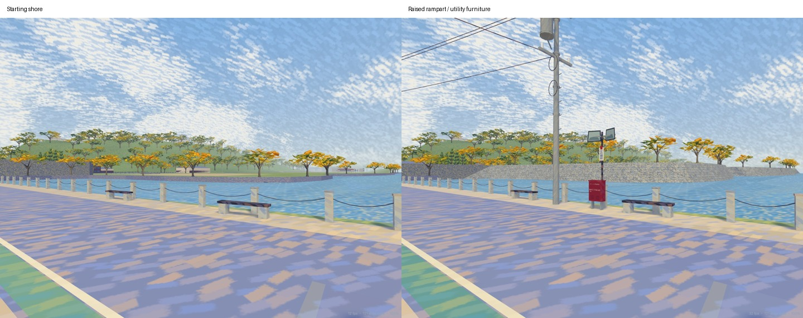

# University-facing middle-moat rampart — IMG_0848

Reviewed 2026-10-30 JST. This local repair follows the owner's `10.29/IMG_0848.HEIC`,
with IMG_0849 as a supporting view. Both originals remain unchanged. The source layer is
[`world/school-moat.json`](../world/school-moat.json): photograph hash, source URLs/checksum,
twelve mapped retaining-wall outlines, GSI sample results and explicit model estimates.

## Evidence and extent

IMG_0848 shows a tall battered stone face, trees above its crest, a concrete distribution pole
with transformer/cable bundles, a red community equipment cabinet and two confirmation mirrors.
The cabinet's readable inscription is **城町2丁目自治会**. Its front has a latch, lower vents,
projecting top lip and two legs. These details distinguish it from the university's existing
cylindrical entrance post box.

The original GPS fix is 35.2761533333, 136.2471916667, approximately local (-605.00, 143.57),
with 6.82 m reported horizontal error; the camera heading is 89.45 degrees true. It is supporting
evidence, not a calibrated camera or an exact cabinet/pole location. The actual street/shoulder
and neighboring benches constrain the photo-relative placements.

A bounded [OpenStreetMap API response](https://api.openstreetmap.org/api/0.6/map?bbox=136.2468,35.2712,136.2534,35.2777)
contains connected stone retaining-wall polygons from the photographed western reach toward
Kyobashi: ways 1449647546, 1449647545, 1449647544, 1449647543, 1449647542, 1449647541,
1449647540, 1449647539, 1449647538, 1449647537, 1449647536 and 1449647535. All twelve carry
`material=stone`, `barrier=retaining_wall` and `height=5.5`. The [Kyobashi-guchi description](https://www.hikoneshi.com/sightseeing/article/kyobashi-guchi)
also identifies the gate on the middle moat. These sources support the wall's continuation;
they do not make every retained model coordinate a surveyed wall corner.

The [GSI elevation API](https://maps.gsi.go.jp/development/elevation_s.html) returns 1 m laser
samples of 86.5 m at the registered west street, 90.4 m near the opposite crest and 87.5 m
farther into the school plot. These support a raised perimeter with a falling inner slope.
Some southern samples have only 10 m resolution and cannot resolve the stone face. The
record preserves every request/result. Absolute elevations are not copied into the project's
local height datum.

The **new modeled reach is about 419 m**, along the first fifteen existing SCHOOL_BANK
vertices, approximately **X=-557.5 to -220, Z=84 to 232.4 m**. It joins the pre-existing raised
bank at X=-220 and continues through that model toward Kyobashi's retained bridge opening.
The registered waterline, roads and bridge coordinates remain authoritative. The downloaded
OSM outlines are retained as evidence; this pass does not replace every shoreline coordinate.

## Completed repair

- Replace the low grass/water-edge strip with actual inclined masonry, irregular grey stone
  cells and a backed earthen bank. Nominal toe Y=-1.35 plus the 5.5 m source height gives crest
  Y=4.15. The join blends to the existing crest Y=4.35, 4 m batter and existing rear-ground
  profile. The local 3 m batter and approximately 9 m back-edge distance are visual estimates.
- Cut out low ground beneath the raised surface. The same triangulated soil profile is
  exported to `data/road_tiles.json`; the visible terrain receives no renderer-only offset.
  Reuse the existing shoreline tree inventory on the crest with matching root heights.
- Interpret the adjacent mapped school-gate return's 5.5 m height from the retained toe datum,
  rather than treating 5.5 as its absolute local top. Its source outline is retained.
- Remove the false retaining face at the middle-moat model partition. The adjoining native
  water is included when deciding whether an edge is an exposed shore, so no stone blade
  crosses the water at X=-220.
- Add the photographed tapered concrete pole, crossarms, insulators, ribbed transformer,
  cable loops and sagging overhead spans. They reuse modeled supports; exact attachments and
  individual wires are estimates. Lowest cable spans remain above the traffic space.
- Add the rectangular red cabinet with readable community label, top fold, door/latch,
  ventilation slots and legs. Add the paired grey mirrors, bracket, red arrow and 左右確認
  sign. The mirrors use static painted surfaces, without a reflection render pass.
- Shift the three nearby existing backless benches 0.25 m toward their bollard line. Their
  earlier placement narrowed the body corridor even in the starting model; the repaired strip
  keeps a continuous 0.6 m body corridor past the benches and new furniture.

The pole is approximately (-588.51, 149.96); the cabinet (-588.62, 147.35); the mirror post
(-588.24, 147.33). They are photo-relative estimates projected onto the existing shoulder,
not GPS readings of those objects. Exact hidden cabinet fittings, small pole identifiers,
stone-by-stone survey geometry and the full school site's absolute terrain remain unconfirmed.
No new satellite or Street View comparison is claimed.

## Sources and construction

OSM-derived coordinates remain attributed to **OpenStreetMap contributors, ODbL-1.0**.
Source: **Geospatial Information Authority of Japan, elevation API**,
https://maps.gsi.go.jp/development/elevation_s.html . Its samples are processed here into an
estimated relative model profile by this project; this model is not a GSI product.
[GSI content terms](https://www.gsi.go.jp/kikakuchousei/kikakuchousei40182.html) specify PDL-1.0
unless otherwise stated and require source/processing attribution. No source photograph or
provider map raster is embedded in the runtime model.

`tools/school_moat.py` owns the bank profile, stone treatment and street furniture.
`tools/university.py` uses it for native meshes, ground and water-edge ownership.
`world/field-observations.json` retains the adjacent return's source height and toe datum.
`tools/field_photos.py` applies that explicit datum. Scene code, scenario routes, signal controls,
accident timing and the geographic frame are unchanged.

```sh
npm ci
blender -b --factory-startup --python tools/build_impressionist.py -- --only ART_WestMoat ART_ShigaCampus ART_EastHikoneBuildings
blender -b --factory-startup --python tools/build_native_models.py -- --only ART_WestMoat ART_ShigaCampus ART_EastHikoneBuildings
node tools/build_collision.mjs
blender -b --factory-startup --python tools/build_editor_map.py
npm run check
node tools/check_routes.mjs
```

The focused regressions inspect exported ground continuity, the actual stone face in both
detail levels, clear body space past the furniture and the removed false face across the water.
The earlier bank-closure regression now accepts a genuine inclined face behind its toe.

## Validation and images

`npm run check` passes strict types, generated-document checking, all **314 tests**, zero
failures/skips, and the production build. The focused bank/university/obstacle checks pass
**38 tests**. All **46 vehicle routes** pass `node tools/check_routes.mjs`. Collision is rebuilt
at 0.2 m: 1,313 objects, 6,586,269 blocked cells. The final atlas is refreshed from the GLBs.
`git diff --check` passes. The production build retains its large-chunk advisory.

The [browser record](school-moat-0848/browser.json) checks actual walking/cycling player
traversal through the gate, along the cabinet/pole/bench corridor and through the south alley:
six continuous traversals with body/wheel collision and Ground enabled. Existing walking
01/cycling 07 also accept keyboard looking/movement, switch replay views, reach results and
return to the menu. Contact uses the existing debug hook for this replay smoke check.
The 390 px editor opens at (-596.6, 178) with matching coordinate inputs and no horizontal
overflow. Page/console errors: zero. The [production phone-width check](school-moat-0848/production.json)
also loads the new native scene at 390 px and verifies the raised Ground profile. A real phone
or VR headset has not been tested.



[Street before](school-moat-0848/photo-before.jpg) · [Street after](school-moat-0848/photo-after.jpg) ·
[Bank join before](school-moat-0848/seam-before.jpg) · [Bank join after](school-moat-0848/seam-after.jpg) ·
[Cabinet and utility details](school-moat-0848/furniture-after.jpg)

These are simulator captures using the same fixed cameras. The starting native programs and
ground/collision files are frozen from the starting worktree and served through the same app.
Camera registration is approximate, rather than a calibrated recreation of the EXIF pose.

The [same-page rendering record](school-moat-0848/rendering.json) uses Chrome at 1280×800,
reduced motion, the same renderer/source, two-second warmup and eight-second samples per
fixed camera. Starting native programs and ground data are frozen; no model-generation or
regression processes run during this comparison.

| View | Draw calls before → after | Triangles before → after |
| --- | --- | --- |
| Photographed corridor | 153 → 153 | 4,577,098 → 4,588,097 |
| Cabinet / pole | 140 → 140 | 4,827,414 → 4,838,413 |
| Bank join | 46 → 46 | 3,851,334 → 3,857,449 |
| Practice junction | 110 → 110 | 1,581,001 → 1,588,505 |

Resident geometry buffers change 73,655,048 → 74,713,069 bytes (**+1.06 MB, +1.4%**).
These are geometry counters, not total browser/VRAM use. Median frames span
16.7–16.7 ms before and 16.4–16.7 ms after;
p95 spans 17.5–17.7 ms before and 17.4–17.7 ms after.
The capped desktop sample establishes no mobile performance result or speed improvement.

[Verification and preservation record](school-moat-0848/verification.json) identifies the
regenerated files and confirms the retained geographic/scenario sources and all starting
photographs are unchanged. No commit, push or deployment is performed.
