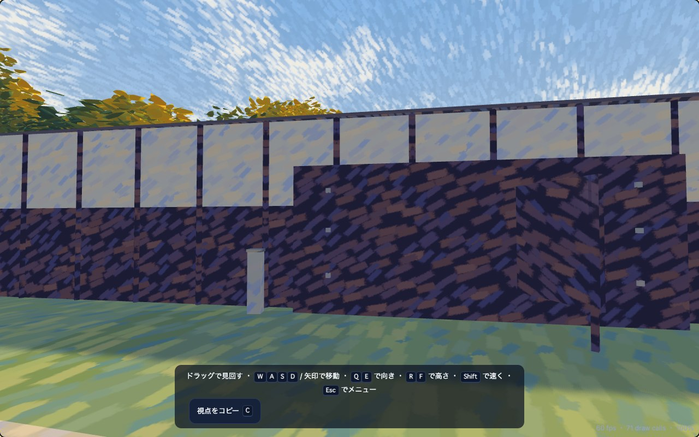
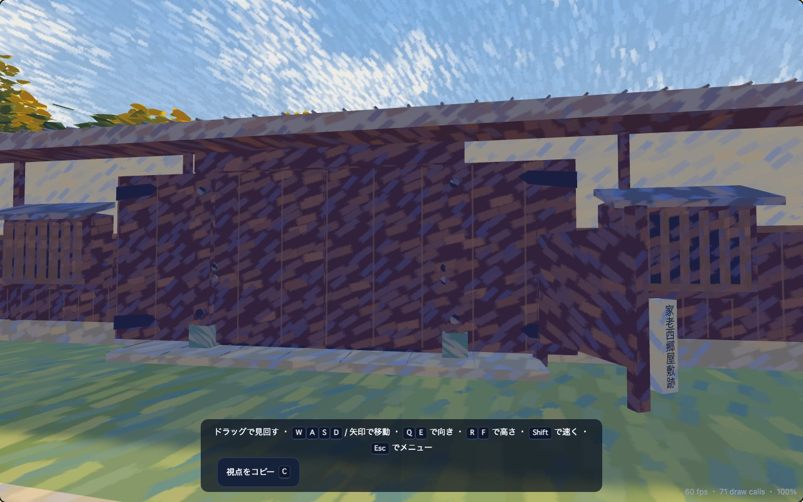
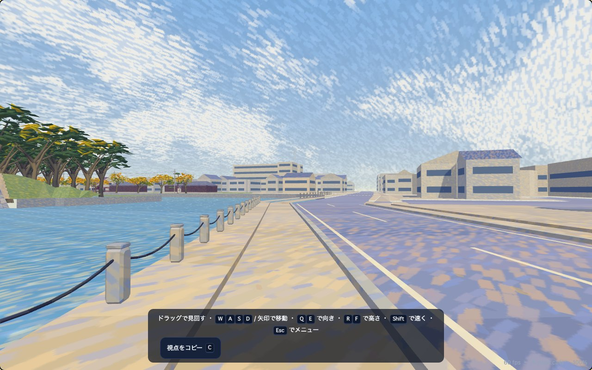
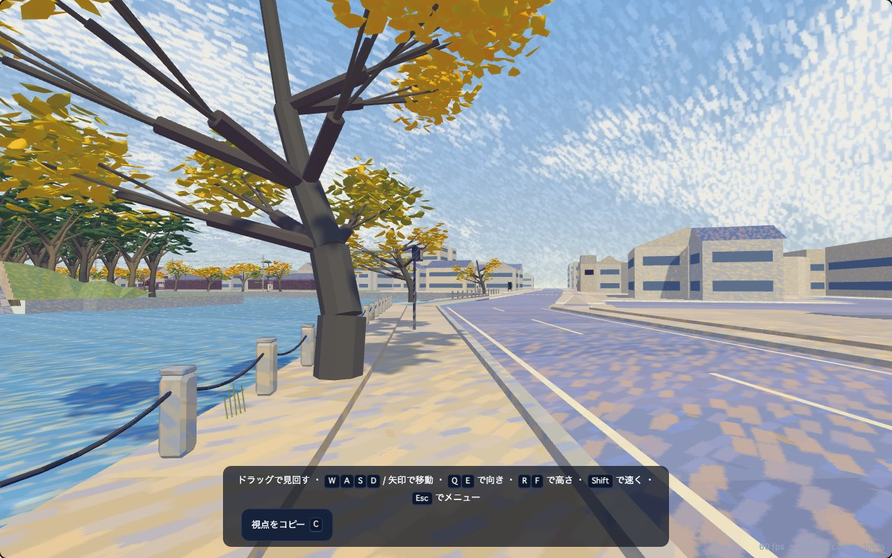
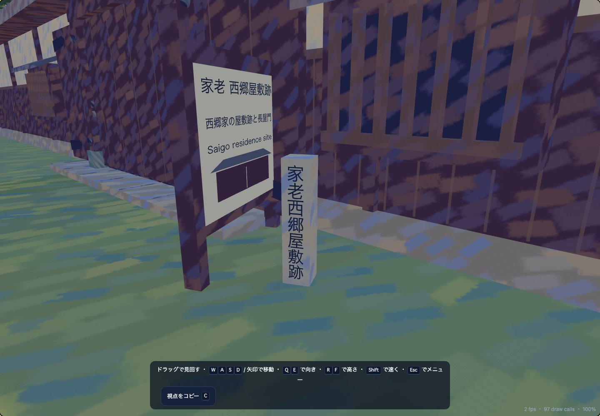
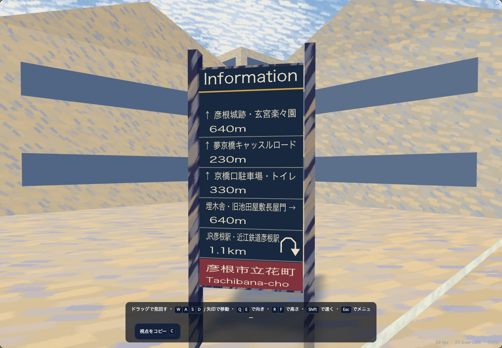

# Saigo and the south moat promenade

Pedestrian review of `05-saigo-kyobashi` and `06-east-moat-promenade`, 31 October 2026.
The existing scene is refined locally, with warm plaster and timber, violet-brown shadows
and the existing Renoir-inspired pigment finish. Sign lettering uses non-emissive
`ART_DisplayInk`, triangulated offline, without the brush pattern over its text.

## Evidence and registration

All 28 originals, IMG_0867–IMG_0894, were inspected locally, including native-pixel
crops of the stone inscription and information boards. Original hashes match the local
photo index. Capture date: 29 October 2026. GPS horizontal errors are 3.0–12.9 m;
headings are approximate. No EXIF altitude is used as a terrain datum. Originals and
inspection derivatives remain outside tracked assets, and no photo is a texture.

Existing OpenStreetMap data supplies registered outlines, facilities, footways and the
tower node. The snapshot URL, hash, ODbL attribution, explicit placements, estimates and
limitations are in [the source record](../world/south-promenade.json). The coordinate
frame is unchanged: map metres, +Z bearing 32°, +X bearing 122°, and the shared anchor
35.27246 N / 136.2526297 E → (32, 56.8). This pass did not access new Google satellite,
Street View or GSI imagery; earlier map checks are not presented as a new comparison.

## Corrections

| Area / photographs | Problem at walking height | Authored correction |
| --- | --- | --- |
| Saigo longhouse, 0867–0868 | Blank timber panels, shallow door detail and no readable stone inscription | Registered footprint retained; stone plinth/apron, paired closed plank doors, strap hinges, studded posts with green metal shoes, side wicket, projecting barred windows, sloping window hoods and closed tiled eaves. The stone reads **家老 西郷屋敷跡**, correcting the older OSM-derived label. |
| Kyobashiguchi, 0869–0872 | Placeholder interpretation board | Timber frame and readable Japanese/English identification, factual paraphrase of the photographed explanation, and an original steps diagram. Existing stone enclosure, road turn and gangi geometry retained. |
| Kyobashi, 0873–0878 | Dense vertical balusters did not match the photographed horizontal railing | Three horizontal members, short square intermediates, larger newels and patinated finials on the existing deck and road corridor. |
| Maps, 0875–0876 / 0887–0888 | Upright blank boards on thin legs | Sloping metal trays on thick granite piers, readable title and original OSM schematic. The west board includes the photographed boat-landing direction; the east board has its adjacent smoking-area notice. Copyrighted map artwork is not copied. |
| Benches, 0881–0883 | Solid seat slabs placed in a straight row across the curved section | Five slatted seats with inclined backs and stone legs, facing the moat and following the retained bank. Explicit source/placement separation retained. Gravel openings replace two overlapping shrub patches. |
| Promenade, 0880–0888 | Guidance paving stopped at X=82; missing older tree silhouettes and lanterns | Flush tactile strips continue along the actual bent footway and the mapped eastern walk; three sparse, leaning autumn cherries and three cantilevered square lanterns. Existing chain posts remain the shore boundary. |
| East landmark, 0883–0889 | Generic antenna silhouette | Three projecting square platforms, diagonal braces, guardrails and a slender upper mast on the existing mapped tower location. No invented base building. |
| Shop, 0892 | Generic continuous window bands | A medium-confidence match to OSM way/1412461608: north-facing upper window band, two closed shutters, glazed display, modest rooftop room and railing. The frozen footprint remains; hidden rooms and temporary trucks/posters are absent. |
| Tachibana corner, 0893–0894 | Missing directory | Physical two-sided dark/red **Information** totem with photo-date destinations and distances, fitted behind the mapped public walking line. Text layout is simplified for reading; it is not a live navigation or traffic-order service. |

The shared curved-roof helper also had an inward-facing soffit, exposed by looking up
under Saigo's eaves with front-face culling. Its interior reference now sits above the
soffit, fixing the underside without changing the existing northern roofs' geometry.

## Limits

The main work covers approximately X −17–275, Z 30–152, plus the existing distant
tower at (432.58, 116.46). This is refinement within the existing map, not an expansion.

The retained south shore is schematic. Bench placements remain about 8–12 m from
their OSM points, fitted to that bank; the two-level asphalt/gravel arrangement in 0881
is compressed into the available verge. Road, water, terrain, event routes and clocks
are retained. This does **not** establish survey-level geographic accuracy.

The shop match has 12.9 m GPS uncertainty; proximity, heading and its long north
frontage support it, but the business identity and exact roof-room dimensions are not
established. The office in 0890–0891 lies beyond the eastern walkable boundary and is
not used to invent another district. The temporary parade closure in 0871 is omitted;
0879's restriction text is readable but its pole is not reliably registered. Hidden
interiors, tiny unreadable text and unobserved business signs are not fabricated.

## Verification

Generated high/low native programs, offline GLBs, editor images and body collision are
checked together. The focused regression sweeps the public paths with body width,
tests street-facing doors, an upward-facing roof underside, solid sloping maps, both
directory faces and foliage viewed from below. The bridge path bends around the
pre-existing paired-sign pole; the mapped walk follows its actual corner beside the
chain posts.

The carriageway-exclusion check also now reads the exported nested triangles correctly,
with a known junction point as a control; its previous flat-array loop could silently
accept a point on the road.

The five small gravel seat openings also have exported Ground at the existing 0.15 m
plot datum; the private verge is no longer render-only support. Existing road, footway,
water and terrain triangles are preserved outside these openings.

`npm run check` passed all **330 tests**, with no skipped tests, strict TypeScript,
generated-document checks and the production build. After the last small board-clearance
adjustment, **79 geometry/collision/native/performance/atlas checks** passed again,
followed by a fresh production build. Both generated PNGs passed integrity checks;
the isolated five-test editor-map rerun passed after an intermediate PNG read failure.
`check_routes.mjs` checked **46 vehicle routes**, all clear. Event-purpose checks for
`builtin-01` (walking) and `builtin-07` (cycling) both reached their goals with the
lawful reference driver; contact remains a physical outcome, not a required result.

Chrome exercised **12 actual controller traversals**: Saigo's verge, both bridge
shoulders, the curved retained walk, mapped eastern walk and directory corner, each
walking and cycling. Keyboard look/movement, participant/overview replay, replay end,
results and return to the menu were exercised in walking/cycling practice. The editor
also opened the new area at a 390 px viewport without horizontal overflow. No page or
console errors were recorded. These are browser checks, not a real phone/Quest test.

The production site also loaded at 390×844 with no overflow, failed requests or GLB
requests. Ground samples under the new seats resolve to 0.15 m; the bridge stays at
0.01 m. The LAN development URL is served on all interfaces, while the editor's write
API retains its existing loopback restriction.

Ground comparison against the frozen starting checkout found no change to any old
triangle group; only the ten seat-pad triangles were added. Water walls, coordinate
frame, events, world traffic and simulation code match their starting hashes. Prior
unrelated working-tree changes and private originals were retained; no commit/push.

Browser results and sampled paths: [verification.json](south-promenade/verification.json).

## Rendering cost

Frozen starting programs/data versus the completed programs on the same Chrome page,
1280×800, reduced decorative motion, identical cameras, two-second warmup plus
eight-second sample per view. Model rebuilds and tests were stopped first. The baseline
also restores the original two shrub patches and excludes the three new cherry instances.

| View | Draws before → after | Triangles before → after |
| --- | --- | --- |
| Saigo | 71 → 71 | 1,659,013 → 1,700,093 |
| Curved promenade | 26 → 28 | 368,169 → 424,179 |
| East low map | 20 → 21 | 1,070,886 → 1,120,496 |
| Practice junction | 115 → 115 | 1,756,330 → 1,792,868 |

Resident scene buffers increased from **93,227,646 to 96,997,747 bytes (+4.0%)**.
These counters are geometry/instance storage, not total browser or GPU memory. Median
frame intervals were 16.7 ms in both variants, p95 18.5–18.6 ms. This display-bound
sample establishes no phone performance or timing improvement. Raw samples and camera
poses: [rendering.json](south-promenade/rendering.json).

## Model-only comparisons

No field photograph or crop is included below. The paired views use the same camera.

| Starting scene | Rebuilt scene |
| --- | --- |
|  |  |
|  |  |

Readable stone and directory, viewed from their reading sides:

Other inspected views: [sloping map](south-promenade/map.jpg),
[bridge](south-promenade/bridge.jpg), [bench reverse](south-promenade/bench-reverse.jpg),
[estimated shop facade](south-promenade/shop.jpg),
[production narrow viewport](south-promenade/production-mobile.jpg).
