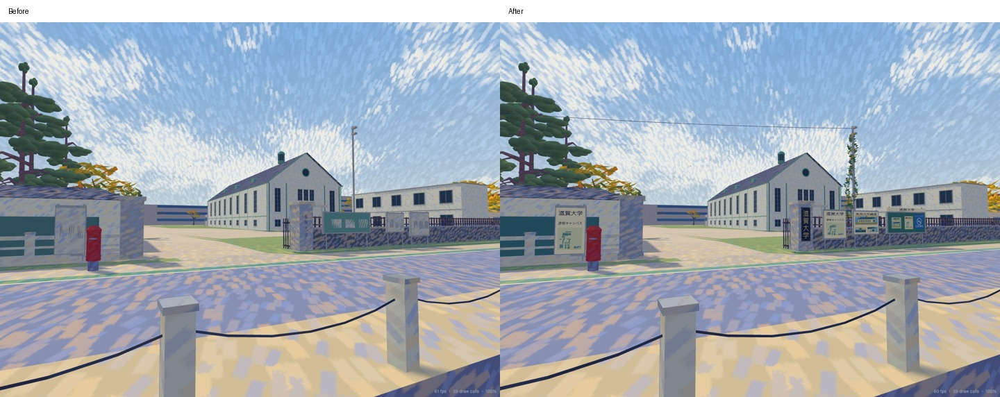
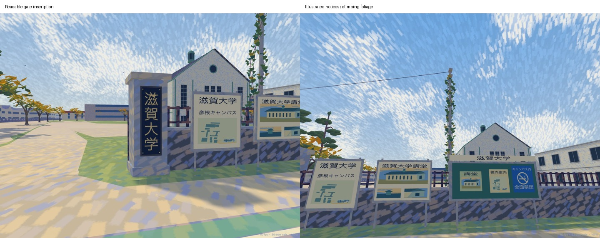

# Shiga University gate: painted-reference refinement

Reviewed 2026-10-30 JST, from the owner's attached impressionist entrance illustration.
This is a local update to the [photograph-based university model](university-photo-modeling.md).
The existing geographic frame, gate centre (-596.6, 178), road surfaces, campus footprints,
hall architecture, event positions and driver settings are retained. The illustration supplies
composition and visual details; it supplies no surveyed dimensions or new GPS control points.

## Visible changes

- Both granite pillars follow the entrance frontage. The former axis-aligned column could
  overlap its inscription plane. The named pillar now has a physically attached dark plaque
  and four shallow gold characters, 滋賀大学. Correct reader direction and high contrast
  preserve the inscription inside the surrounding warm/cool stone brushwork.
- The street-facing panels follow the illustration's order: campus information, auditorium
  illustration, then the green bulletin board. Frames and supports remain three-dimensional.
  The actual local building footprints provide the schematic campus diagram. The auditorium
  elevation, roof-lantern detail and facade detail are original coloured polygon illustrations.
- Readable labels include 滋賀大学, 彦根キャンパス, 滋賀大学講堂, 構内案内 and 正門.
  The blue キャンパス内 / 全面禁煙 panel and cigarette/slash symbol follow the supplied
  reference. Its unclear date and small notice text are left untranscribed. These are static
  scene graphics; this work does not verify current university notices or campus regulations.
- Two climbing stems and folded green/gold leaves cover the existing service pole and a
  nearby campus-side guy. A static sagging cable reuses the nearest modeled utility support.
  Attachments, leaf positions and dimensions are visual estimates. No ground-level wire or
  new pole crosses the gate opening.

## Native implementation

`tools/university_frontage.py` owns the oriented pillars, inscription, illustrations, campus
diagram and climber. `tools/university_photos.py` places the panels and retains the open
gate leaves/tactile paving; `tools/university.py` calls the pillar author in ART_ShigaCampus.
The existing model pipeline builds the high/low native Three.js programs and offline GLBs.
No runtime logic, renderer shader or global paint strength is changed.

Japanese outlines are triangulated by the offline author using the existing
`HIKONE_JAPANESE_FONT` lookup. The built site needs no font download, canvas lettering,
photographic texture or new render pass. Printed surfaces use the existing non-emissive
ART_DisplayInk pigment with explicit vertex colours. Painted illustration marks and the
surrounding stone/foliage retain the scene's impressionist treatment; broad shader dabs do
not erase small text. The supplied illustration is not copied into the shipped model.

```sh
npm ci
blender -b --factory-startup --python tools/build_impressionist.py -- --only ART_ShigaCampus
blender -b --factory-startup --python tools/build_native_models.py -- --only ART_ShigaCampus
node tools/build_collision.mjs
blender -b --factory-startup --python tools/build_editor_map.py
npm run check
```

The added visibility regression samples the first rendered surface across all four exported
characters in both detail levels. It checks that stone cannot cover their gold strokes.
Existing tests retain physical gate/lane clearance, hall sight lines and post-box behaviour.

## Verification and comparisons

`npm run check` passes strict types, generated-document checks, all **310 tests (zero
failures/skips)** and the production build. This includes art, physical obstacles, performance,
university geometry and both new inscription-visibility regressions. The build retains its
large-chunk advisory. Collision is regenerated at 0.2 m: 1,313 objects and 6,561,446 blocked
cells. Ground and water-wall files retain their starting hashes; both map images are refreshed
from the rebuilt GLBs. `git diff --check` passes.

The [browser record](university-gate/style-20261030/browser.json) exercises continuous walking
and cycling through the main entrance and south lane, with actual player body/wheel collision
and ground enabled. It also checks keyboard looking/movement, existing walking/cycling event
replay/results/menu exits and a 390 px editor coordinate view. Replay contact is invoked by
the existing debug hook for this smoke check. Browser page/console errors: zero. These are
desktop and emulated-width checks; no real phone or VR headset is tested. The
[production-preview check](university-gate/style-20261030/production.json) also loads the
inscription at a 390 px phone viewport with no page errors or horizontal overflow.





[Inscription before](university-gate/style-20261030/plaque-before.jpg) ·
[Inscription after](university-gate/style-20261030/plaque-after.jpg) ·
[Boards and vine before](university-gate/style-20261030/vine-before.jpg) ·
[Boards and vine after](university-gate/style-20261030/vine-after.jpg)

The [same-page rendering record](university-gate/style-20261030/rendering.json) compares frozen
starting native programs/ground data with final programs in the same renderer: Chrome,
1280×800, reduced motion, two-second warmup and eight-second samples for each fixed camera.

| View | Draw calls before → after | Triangles before → after |
| --- | --- | --- |
| Main gate | 37 → 37 | 362,315 → 370,433 |
| Frontage | 22 → 22 | 320,401 → 328,519 |
| Inscription | 36 → 36 | 359,510 → 367,628 |
| Practice junction | 110 → 110 | 1,575,491 → 1,581,001 |

Resident geometry buffers rise 72,410,324 → 73,655,048 bytes (**+1.24 MB, +1.7%**).
These counters exclude total browser/VRAM use. Median frame times span 16.5–16.7 ms before
and about 16.7 ms after; p95 spans 18.5–18.6 ms before and 18.0–18.4 ms after. The capped
desktop sample establishes no speed improvement or phone/VR performance guarantee.

The [verification and preservation record](university-gate/style-20261030/verification.json)
identifies regenerated outputs and confirms unrelated starting files, geographic sources and
original photographs are preserved. No commit, push or deployment is performed.
