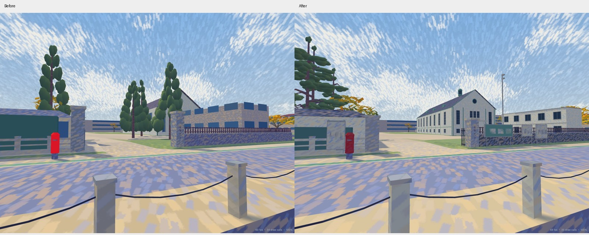

# Shiga University photo-based refinement — 2026-10-29

The later [painted-reference gate refinement](university-gate-painting.md) updates the pillar
inscription, illustrated notices and climbing foliage. It supersedes this report's original
abstract notice panels while retaining the geographical and architectural work described here.

This is a local refinement of the existing campus and moat-side street, based on the owner's eight original files `IMG_0847.HEIC` through `IMG_0854.HEIC`. The originals were inspected and remain unmodified. Their EXIF capture times are 16:01–16:02 JST on 2026-10-29. [Photo metadata and source record](university-gate/photo-survey-20261029.json) preserves file hashes, GPS accuracy and the distinction between observed features and estimated dimensions.

## Registration and evidence

The existing geographic origin, 32-degree rotation, metre scale, world bounds and practice bounds are unchanged. The photographed modeling area is approximately **X=-680 to -580, Z=130 to 235**. The necessary campus-shore connection rejoins the retained outline at approximately **(-683.59, 299.79)**; decorative utility spans reuse the retained supports near X=-692 and X=-612. Source programs generate actual native Three.js geometry and separate high/low offline GLB fixtures; no photograph is stretched over the map.

The EXIF positions are useful supporting evidence, not control points: reported horizontal errors are **4.36–26.89 m**. The photographs do not supply calibrated camera poses, depth or surveyed dimensions. EXIF altitudes near 90 m are above sea level and are **not** used as local terrain or building heights.

The [university's official campus map and front photograph](https://www.shiga-u.ac.jp/information/campus-access/campusmap/) confirm the auditorium's identity and the clapboard, mint trim, circular gable light, arched dormers and roof lantern. The official illustration is schematic, so it supplies no measured dimensions. No official image is redistributed in this project.

[OSM auditorium way 380034661](https://www.openstreetmap.org/way/380034661) was re-read through its public full-way API; the existing footprint matches it and is retained. Three corner nodes of [campus way 180830880](https://www.openstreetmap.org/way/180830880)—1912885128, 2697482806 and 1912885115—replace the old local shore turn before joining the retained northern aerial outline. The university polygon is a campus enclosure proxy for the bank, not a surveyed waterline. [Gatekeeper footprint way 1409173495](https://www.openstreetmap.org/way/1409173495) was also checked; the existing simplified envelope is retained. OSM-derived geometry remains covered by the project's OpenStreetMap attribution and ODbL notice.

## Photo observations and changes

| Photos | Evidence | Implemented change | Remaining uncertainty |
| --- | --- | --- | --- |
| 0847 | Narrow unmarked lane; close residential facades, upper balconies, concrete pole, drainage channels | Three existing north-side mapped facades gain individually framed windows, entry doors, shallow siding joints and balcony rails; flush drains, a grate and static utility geometry follow the existing road | Facade-to-address assignment is an estimate from building order; exact heights, setbacks and utility endpoints are unmeasured |
| 0848–0849 | Moat-side street, green edge band, tall narrow trees behind the stone enclosure, backless benches and chained stone bollards | Retain road alignment and green band; refine muted stone/bench pigments and the gate tree silhouettes | Exact strip widths, species and individual tree positions are estimates |
| 0850–0851 | Open moat, opposite retaining bank, distant buildings and wooded hill | Keep the existing water level, distant buildings, hill and continuous shore context | These oblique views do not support surveyed shore heights or rebuilding distant roofs |
| 0852–0853 | Unobstructed auditorium front; temporary two-storey office farther north; white walls and mint trim | Rebuild the hall's framed window rhythm, front porch, circular light, sheet roof seams, seated arched dormers and glazed lantern; move and detail the temporary office; remove misplaced foreground trees from the hall sight line | Hall heights retain existing estimates; temporary office footprint, height and stair dimensions are photo-relative estimates |
| 0853–0854 | Granite gate posts, folded open gate, cylindrical red post box, service window, green noticeboard and white notice panels | Refine gate post height/caps, open bars, gatekeeper service glazing and hipped roof, noticeboard frames, flush tactile strips, service pole and post-box mouldings | No notice contents, people, exact lettering on small boards or hidden interiors are reconstructed |

The post box uses non-emissive painted metal. It previously reused the red traffic-signal material, which incorrectly emitted light. The gate opening and campus walking-axis coordinates are retained. New furniture has physical body collision from the same generated geometry; it does not change accident schedules or driver rules.

The temporary office's earlier envelope obstructed the hall's front view. Its revised estimated envelope is **X=-617 to -601, Z=208.5 to 214.5**, north of that sight line. The old campus shore turn cut into this plot; the OSM corner correction keeps the replacement envelope on exported dry ground. The rest of the campus, unrelated roads and the previously corrected eastern/northern map remain in place.

The same camera before and after the refinement:



[Gatekeeper view](university-gate/gatekeeper-after-20261029.jpg) · [South alley](university-gate/alley-after-20261029.jpg) · [Mobile editor](university-gate/editor-mobile-20261029.jpg)

## Authoritative implementation

- `src/world/generators/university-layout.js`: campus corner, temporary office envelope and photo-relative tree/furniture positions.
- `tools/university_photos.py`: local architecture and furniture, with restrained geometry detail at a distance.
- `tools/university.py`: shared campus author calls the photo details.
- `tools/east_extension.py`: the same photo author refines the three already mapped alley facades and their street furniture; their source footprints and height metadata remain unchanged.
- `test/university-photos.test.mjs`: generated body corridors, dry office ground, actual exported hall visibility in both detail levels and non-emissive post-box geometry.

Reproduce the generated outputs without Unity:

```sh
npm ci
blender -b --factory-startup --python tools/build_impressionist.py -- --only ART_ShigaCampus ART_WestMoat ART_EastHikoneBuildings
blender -b --factory-startup --python tools/build_native_models.py -- --only ART_ShigaCampus ART_WestMoat ART_EastHikoneBuildings
node tools/build_collision.mjs
npm run check
node tools/check_routes.mjs
```

Campus exports regenerate ground and water walls; the map atlas is rendered from the rebuilt offline GLBs. The native compile refreshes compressed recipe transport. The existing Japanese font requirement for the gate inscription still applies.

## Verification

Final `npm run check` passes **302 tests, zero failures or skips**, including strict types, generated documentation, all event checks and the production build. The final focused art/obstacle/performance/university checks pass **78 tests**, and the route checker passes **all 46 vehicle routes**. Collision was regenerated from the final native recipes: 1,314 objects, 7,400 × 5,125 cells at 0.2 m, 6,558,883 blocked cells. The source frame, all eight photo originals, event configurations and replay/runtime source files outside this geometry change retain their starting hashes. `git diff --check` passes.

The production build was explored through the actual player controller: walking and cycling both pass through the main gate and the south alley, with body/wheel collision and exported ground active. Walking event 01 and cycling event 07 pass keyboard looking/movement, participant/overview replay, replay completion, results and menu exit. The 390-pixel mobile editor opens at the gate coordinates without horizontal overflow. Development and production browser checks report no console/page errors; details are in [the browser record](university-gate/browser-20261029.json).

The final same-page Chrome comparison uses 1280 × 800, reduced motion, a 2-second warmup and an 8-second sample for each fixed camera. Baseline native programs and ground/collision data are frozen from the starting worktree. Both stages use the same final renderer/source. [Raw rendering measurements](university-gate/rendering-20261029.json) retain the camera coordinates and resource counters.

| View | Draw calls before → after | Submitted triangles before → after |
| --- | --- | --- |
| Main gate | 36 → 37 | 299,824 → 361,639 |
| South alley | 149 → 149 | 3,044,092 → 3,103,683 |
| Campus overview | 22 → 22 | 3,818,831 → 3,829,129 |
| Original junction | 110 → 110 | 1,515,653 → 1,526,407 |

Counted scene buffers rise **66,271,847 → 68,234,688 bytes** (+1,962,841 bytes, about 3%). Near-campus triangles increase mainly for the framed architecture and gate trees; the distant campus geometry changes less. Medians remain 16.6–16.7 ms and p95 samples span 18.5–18.8 ms. These desktop results establish no speed improvement or mobile guarantee. Buffer counts are not total VRAM, and the routed fixture is not a network/loading benchmark. No new image textures, render passes or moving shadow casters are introduced.

Final test totals, collision dimensions, generated-file hashes and preservation checks are in [the verification record](university-gate/verification-20261029.json). No real phone or VR headset was tested. The work is a photograph-informed local model, not a survey or a complete reconstruction of the whole university.
