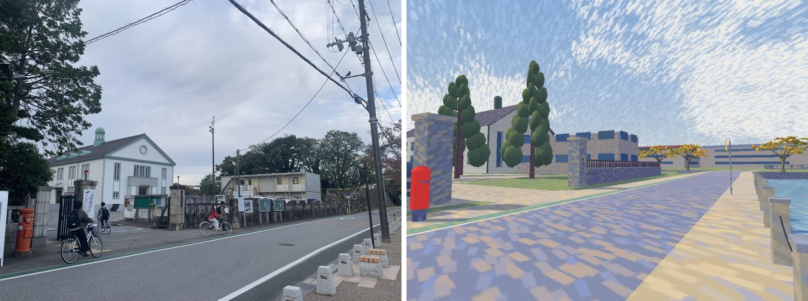

# Whole-map geographic coverage — 29 October 2026

The editor/world extent (X=-1060–420, Z=-155–870 m) previously showed flat green filler in the
west and south-west and grey blanks in the north-east, south-east and along the edges. Everything
outside a **retained authored core** is now built from the same frozen OSM pipeline as the
[eastern extension](east-extension.md) and [north correction](north-correction.md): streets,
footways, parking, moats/canals, parks and woods, and every mapped building as a 3D volume.
This document supersedes those two reports on coverage, building heights and camera bounds.

## Retained core and coverage

`world/geographic-frame.json` → `east.retained` is the authored polygon that stays hand-built.
In the Kyobashi practice town it keeps only what the ten events and the open-world corridor use:
Route 25 with its sidewalks (south edge z≈19.5), the junction landmark block (the photographed
corner shop, storehouses, three-storey house, west corner and longhouse, down to z≈0), the
event 07/08 car park (x −108…−31, z −36.5…19) and Castle Road with its sidewalks (x 22.5–42.5)
to the south edge of the map. Elsewhere it keeps the castle hill and compound, Shiga University
with its moat, the southern moat road and the castle approach. Its `excludeWater` entry removes the
mapped **inner moat** (OSM way 45731153) north of Z=380 from that core. `tools/import_east_map.py`
derives `east.coverage` (world rectangle minus core, one polygon without holes) and its convex
`east.pieces`; both are generated, not edited by hand. The former rectangular `cutouts` are gone.

Authors clip retained geometry against that polygon (`east_extension.Ownership`: a 2 m state
raster for quick accept/reject and exact half-plane clipping only at the seam). University
models are now clipped too. Where a clipped ground face meets mapped water, a stone skirt closes
it down to the water datum; land/road seams keep the fill's own step faces so paths stay open.
`inEastExtension()` in `src/world/generators/east-layout.ts` tests the same polygon for layout
items.

## Corrections against reality

Checked against [Google satellite imagery](https://www.google.com/maps/@35.2760,136.2510,17z/data=!3m1!1e3)
(viewed in the browser on 29 October 2026; nothing copied or shipped) and the OSM snapshot:

- The castle hill extended about 40 m north over the real **inner moat**; the moat was missing
  on the whole north side. The moat now wraps the hill to Kuromon bridge, and the hill and its
  planting end at the moat's inner edge.
- Genkyū-en and Rakuraku-en (garden, pond, woods), the north-east middle moat, the former Hikone
  port channel and the canals/drains are now present.
- The authored road west of the campus ran up to 30 m from the real street and continued north
  through blocks that are houses; it is replaced by the mapped streets outside the core.
- The flat green west/south-west and the grey north-east/south-east are dense residential
  districts; they now carry their mapped streets and footprints.
- The practice town south of Route 25 had sparse generic machiya and kura on invented plots,
  its two cross streets stopped at x=−160/155, and the western N–S street and the cross street's
  real bend were missing, so it did not join the surrounding district. Its side streets, blocks
  and buildings now come from the same source; the generic houses are removed there.

## Shiga University main gate (owner photos)

Eight owner photos (`IMG_0847`–`IMG_0854.HEIC`, 29 October 2026, with GPS position and compass
bearing) were placed in the local frame: they cover the moat-side street 城町金亀線 from the lane
south of the campus (x≈−655, z≈145) to the gate (x≈−588, z≈169–189). Phone GPS is good to a few
metres; OSM outlines decided positions and the photos decided form.

- The gate moved 15 m east to the roadside (OSM driveway 380034677 at boundary 180830880); the
  former position was a Maps label pin, and the photos show no forecourt in front of the gate.
  Tall granite posts with caps, the 「滋賀大学」 plaque on the north post, a folded black sliding
  gate and the red cylinder post box outside the south post.
- Gatekeeper's room on its OSM footprint (way 1409173495) just inside, south of the opening.
- Frontage: granite post-and-rail balustrade with a clipped hedge from the campus corner to the
  gate; concrete wall with a timber palisade north of it; the campus corner follows OSM's notch.
- Auditorium on its OSM footprint with a dark brown roof; the patina lantern sits near the front
  gable and the dormers are patina, as photographed. A two-storey prefab site office behind the
  north wall, tall conifers around the gate.
- Moat promenade: stone bollards with chains, backless benches and the map board, kept on the
  street's paved moat-side shoulder over OSM's bollard line; corner mirror; green cycle band
  inside the western edge line.
- The lane and houses between Route 25 and the campus wall (IMG_0847) are the mapped ones: the
  retained core now ends at the campus wall, and the placeholder frontage boxes there are removed.



Not reproduced: signage text, notice boards' content, overhead wires on this street, or the
castle-side stone wall's exact height across the moat.

## Sources and estimates

OSM snapshot: [bbox 136.2410,35.2688,136.2612,35.2840](https://api.openstreetmap.org/api/0.6/map?bbox=136.2410,35.2688,136.2612,35.2840)
plus the complete [moat relation 3548105](https://api.openstreetmap.org/api/0.6/relation/3548105/full),
© OpenStreetMap contributors, [ODbL](https://www.openstreetmap.org/copyright). Hashes, element
versions and the summary are in `world/east-hikone.json`.

| Element | Rule |
| --- | --- |
| Buildings | 1483 mapped footprints. 5 have an OSM height or storey count; the rest use an **estimate from type and footprint area** (`heightBasis`): sheds/garages 2.6 m, houses 3.2/6.2/7.5/10 m by area, apartments/commercial/public 7/10/13 m, temples 6.5 m. Compact house outlines (30–260 m², ≥86 % of their minimum rectangle) get a gable roof along the long axis (936 buildings). Walls carry one window band per storey. |
| Streets, footways | Mapped centre lines with the existing class-width estimates; never through a footprint. |
| Parking | Mapped surface car parks as asphalt (`lot` partition, exported as `East Hikone parking`). |
| Water | Water areas and the moat relation; line waterways (river/canal/stream/drain/ditch) as estimated channel widths, except culverts and underground layers. |
| Green and trees | Mapped parks, gardens, woods, pitches and grass. Woods receive an illustrative deterministic grove planting (9 m), parks and gardens 13 m, clear of streets, water, parking and buildings; individually mapped trees stay at their node. |

Building heights, roof forms, window bands, channel and street widths and planting density are
**estimates for a believable scene**, not surveyed values. Signals in the new districts are not
modelled; the practice town's signals and events are unchanged.

## Runtime

The three district models are light (about 19k, 0.7k and 57k triangles), so
`ENVIRONMENT_CELLS` draws each as one cell rather than ~100 small 96 m cells. Camera bounds stay
per building (`EAST_CAMERA_SOLIDS`, from `world/east-hikone-layout.json`); the solids are bucketed
in 16 m cells when built. Place labels list signal junctions and named buildings of at least
250 m² only, to keep the editor overview legible.

## Reproduction

```bash
python3 -m venv /tmp/osm && /tmp/osm/bin/pip install 'shapely>=2.1'
/tmp/osm/bin/python tools/import_east_map.py --osm bbox.osm --water relation-3548105.osm --source-url '<bbox URL above>'
blender -b --factory-startup --python tools/build_impressionist.py -- --only ART_CastleApproach ART_EastHikoneSurface ART_EastHikoneWater ART_EastHikoneBuildings HK_Terrain_Hikone ART_HikoneCompound ART_KyobashiRoads ART_KyobashiLand ART_KyobashiBanks ART_KyobashiWater ART_ShigaCampus ART_WestMoat
blender -b --factory-startup --python tools/build_native_models.py -- --only <same list>
node tools/build_collision.mjs
npm run check && node tools/check_routes.mjs
```

The impressionist build also regenerates the editor images. Shapely is an offline importer
dependency only.
